<div align="center">

<picture>
  <source media="(prefers-color-scheme: dark)" srcset="docs/assets/banner-dark.svg">
  
</picture>

[](https://github.com/CBFerrum/Ferrum/actions/workflows/ci.yml) [](https://github.com/CBFerrum/Ferrum/actions/workflows/cluster.yml)      

**The open-source, AI-first business platform.**<br>
A metadata-driven ERP in Rust on PostgreSQL: ERPNext's good ideas (documents, child tables,
submit/cancel lifecycle, customize-without-code) on foundations that are exact, append-only and
built to scale out.

[Why Ferrum](#why-ferrum) · [Screenshots](#screenshots) · [Apps](#apps) · [Architecture](#how-it-fits-together) · [Quick start](#quick-start-development) · [AI agents](#ai-agents-mcp) · [Customizing](#customizing-without-code) · [Plugins](#plugins-turn-ferrum-into-any-platform) · [Deployment](#deployment) · [Docs](#documentation)

</div>

---

## Why Ferrum

<table>
<tr>
<td width="33%" valign="top">

**💰 Exact money**<br>
Decimals everywhere (`rust_decimal`, `NUMERIC`); one tax/totals engine (`ferrum-calc`) shared by
server and browser (WASM), with largest-remainder rounding.

</td>
<td width="33%" valign="top">

**📒 Ledgers you can trust**<br>
Append-only journal with a deferred balance check in the database, per-company accounting periods
that refuse postings once closed, receivables/payables as an open-item subledger the database
refuses to over-allocate, hash-chained audit trail.

</td>
<td width="33%" valign="top">

**📦 Inventory without reposting**<br>
Every stock move is valued once at posting time (moving average or FIFO cost layers); balances
are locked in a fixed order so concurrent postings can neither deadlock nor drive stock negative.

</td>
</tr>
<tr>
<td width="33%" valign="top">

**🛠️ Customizable without code, safely**<br>
Custom fields land in JSONB (no `ALTER TABLE`), rules are CEL expressions, plus workflows,
automations, webhooks, print templates and per-tenant packages — all layered over the shipped
metadata so upgrades never clobber them.

</td>
<td width="33%" valign="top">

**🧩 Plugin-centric**<br>
Functionality ships as packages (YAML entities, overlays, roles, seeds, SQL). Tenant code runs as
sandboxed WebAssembly plugins with fuel and memory limits and no ambient capabilities.

</td>
<td width="33%" valign="top">

**🌐 Multi-tenant and horizontally scalable**<br>
Row-level security on every table, stateless API replicas, background work coordinated through
the database (no single point of failure).

</td>
</tr>
<tr>
<td width="33%" valign="top">

**🤖 AI agents as first-class users**<br>
A built-in MCP server covers every entity, action, workflow and report, customizations included;
agents work as the signed-in person, within their permissions, in the audit trail.

</td>
<td width="33%" valign="top">

**🏪 Apps, installed per workspace**<br>
CRM, Helpdesk, HR, Mail, Drive and more are apps in their own repositories; each workspace
installs what it needs from **Apps**, and third parties publish their own through the store.

</td>
<td width="33%" valign="top">

**📱 On every device**<br>
The suite, and any app that asks, installs from the browser like a native app, with its own icon,
notifications on the device (Web Push) and an unread badge.

</td>
</tr>
</table>

## Screenshots

<picture>
  <source media="(prefers-color-scheme: dark)" srcset="docs/assets/home-dark.webp">
  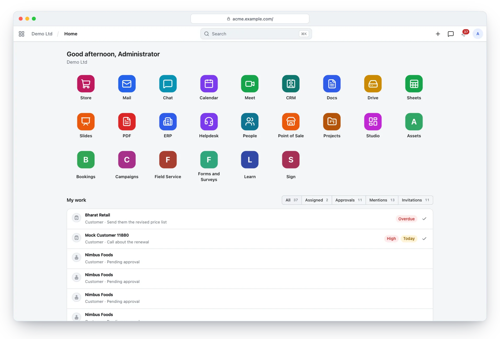
</picture>
<p align="center"><sub>Home: every app in the workspace, then what waits for you — assignments, approvals, mentions.</sub></p>

<table>
<tr>
<td width="50%">
<picture>
  <source media="(prefers-color-scheme: dark)" srcset="docs/assets/launcher-dark.webp">
  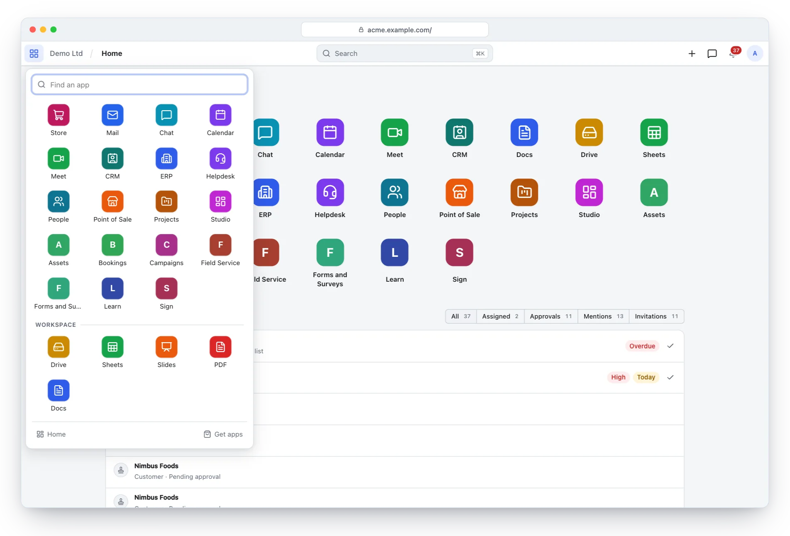
</picture>
<p align="center"><sub>The launcher: every app, one click from any page.</sub></p>
</td>
<td width="50%">
<picture>
  <source media="(prefers-color-scheme: dark)" srcset="docs/assets/search-dark.webp">
  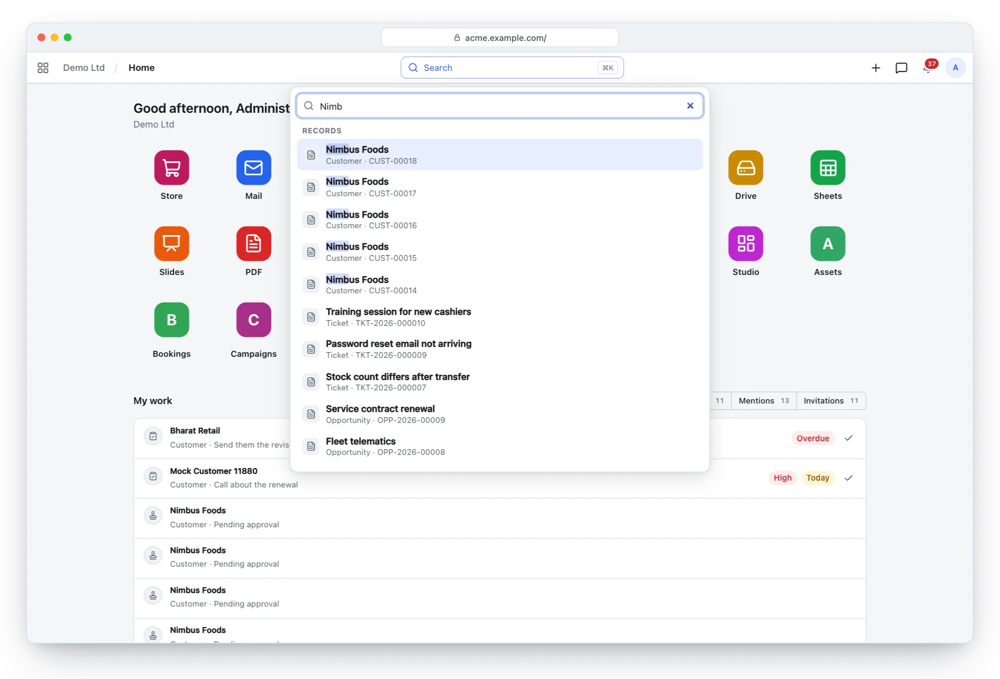
</picture>
<p align="center"><sub>Search from the bar finds records across the workspace's apps as you type.</sub></p>
</td>
</tr>
<tr>
<td width="50%">
<picture>
  <source media="(prefers-color-scheme: dark)" srcset="docs/assets/app-manager-dark.webp">
  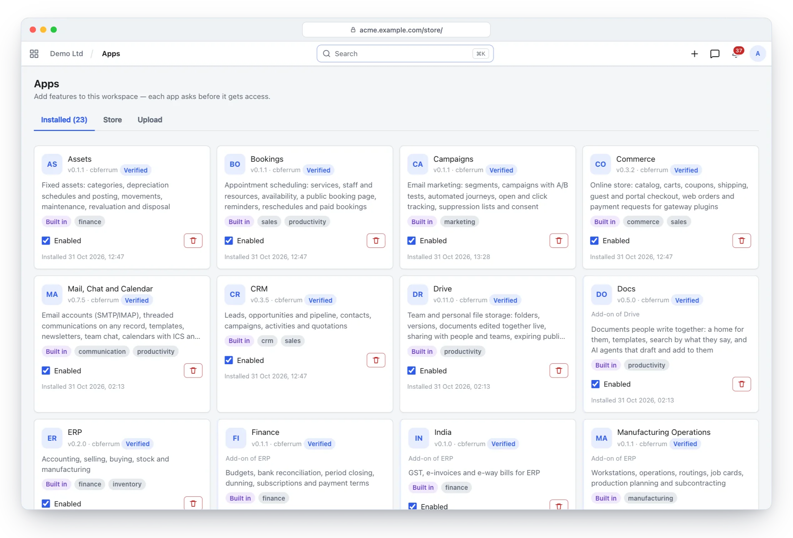
</picture>
<p align="center"><sub>Apps: install, upgrade and remove per workspace; each app asks before it gets access.</sub></p>
</td>
<td width="50%">
<picture>
  <source media="(prefers-color-scheme: dark)" srcset="docs/assets/devices-dark.webp">
  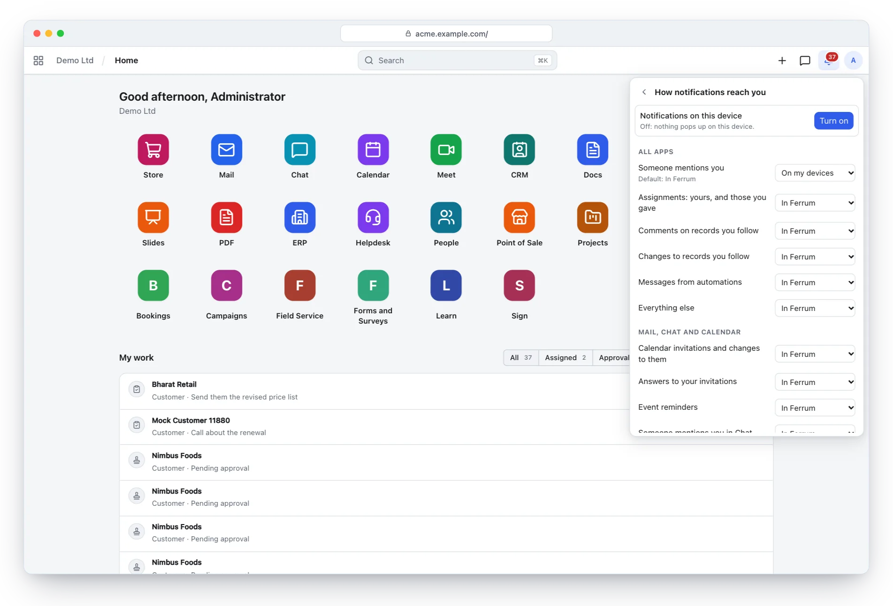
</picture>
<p align="center"><sub>How notifications reach you, kind by kind: in Ferrum, by email, in a digest or on your devices.</sub></p>
</td>
</tr>
</table>

### On every device

<table>
<tr>
<td width="62%" valign="middle">

- 📲 **Installs like an app.** The suite installs from the browser as one app, and an app that
  asks for it (Point of Sale, for a till) installs on its own, each with an icon the server draws.
- 🔔 **Notifications on the device.** Web Push with keys the server makes and keeps sealed; each
  signed-in browser subscribes on its own and signing out stops it.
- 🔴 **Unread badge** on the installed app's icon.
- 📐 **Fits a phone.** The bar, Home and the apps' interfaces adapt to small screens.

</td>
<td width="38%" align="center">
<picture>
  <source media="(prefers-color-scheme: dark)" srcset="docs/assets/phone-dark.webp">
  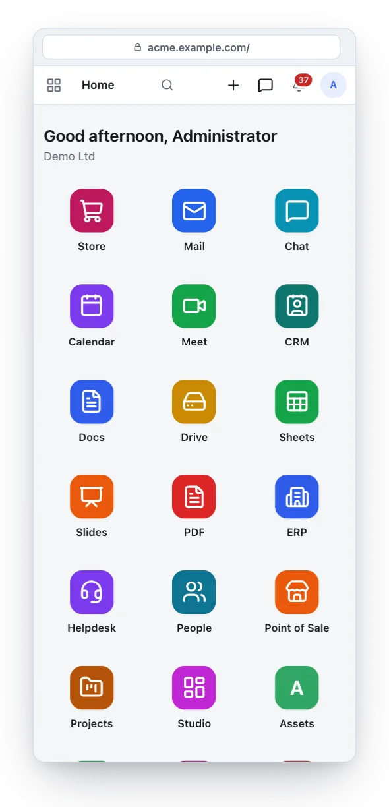
</picture>
</td>
</tr>
</table>

> [!TIP]
> The screenshots follow your GitHub theme: switch between light and dark to see both.

## Apps

Larger business areas are native apps in their own repositories, installed per workspace from
**Apps** (or the app store) like a WordPress plugin; the server image ships them as cargo features.
Third parties build wasm or metadata apps with the [SDK](https://github.com/CBFerrum/ferrum-sdk)
(`ferrum-app new`, `pack`, `sign`, `publish`) — an EV-charging (OCPP) back end, a clinic, a school
or any other vertical is a plugin, not a fork.

| | App | What it brings |
|---|---|---|
| 🏢 | **[ERP](https://github.com/CBFerrum/ferrum-app-erp)**<br><sub>ferrum-app-erp</sub> | Accounting, selling, buying, inventory and manufacturing on one universal journal; India's GST; Finance, Procurement, Stock Operations and Manufacturing Operations as add-ons |
| 🤝 | **[CRM](https://github.com/CBFerrum/ferrum-app-crm)**<br><sub>ferrum-app-crm</sub> | Leads, a pipeline you can drag, quotations and every touchpoint, beside the books |
| 📋 | **[Projects and timesheets](https://github.com/CBFerrum/ferrum-app-projects)**<br><sub>ferrum-app-projects</sub> | Task trees with dependencies, timesheets, billing by time or milestone, profitability |
| 🎧 | **[Helpdesk](https://github.com/CBFerrum/ferrum-app-helpdesk)**<br><sub>ferrum-app-helpdesk</sub> | Tickets with business-hours SLAs, fair assignment and a knowledge base |
| 🧾 | **[Point of sale](https://github.com/CBFerrum/ferrum-app-pos)**<br><sub>ferrum-app-pos</sub> | A till that keeps selling when the connection drops, priced by the server's own engine |
| 🛍️ | **[Commerce](https://github.com/CBFerrum/ferrum-app-commerce)** (online store)<br><sub>ferrum-app-commerce</sub> | A store on your real catalog, stock and prices; checkout books a sales order in one step |
| 👥 | **[HR and payroll](https://github.com/CBFerrum/ferrum-app-hr)**<br><sub>ferrum-app-hr</sub> | People, attendance, leave, recruitment and payroll that posts one balanced entry |
| ✉️ | **[Mail, chat, calendar and video meetings](https://github.com/CBFerrum/ferrum-app-comms)**<br><sub>ferrum-app-comms</sub> | Hosted mailboxes with webmail, or your own provider; threaded onto the records they are about |
| 🏗️ | **[Fixed assets](https://github.com/CBFerrum/ferrum-app-assets)**<br><sub>ferrum-app-assets</sub> | From purchase to disposal, exact to the cent, every posting in the ledger |
| 📅 | **[Bookings and appointments](https://github.com/CBFerrum/ferrum-app-bookings)**<br><sub>ferrum-app-bookings</sub> | A public booking page, exact availability and no double bookings |
| 🚚 | **[Field service](https://github.com/CBFerrum/ferrum-app-field-service)**<br><sub>ferrum-app-field-service</sub> | Work orders from request to invoice: scheduling, dispatch, parts, checklists, signatures |
| 📝 | **[Forms and surveys](https://github.com/CBFerrum/ferrum-app-forms)**<br><sub>ferrum-app-forms</sub> | Conditional logic, exact analytics and a record made from every response |
| 🎓 | **[Learn](https://github.com/CBFerrum/ferrum-app-lms)**<br><sub>ferrum-app-lms</sub> | Courses, quizzes, assignments and certificates |
| 🗂️ | **[Drive](https://github.com/CBFerrum/ferrum-app-drive)**<br><sub>ferrum-app-drive</sub> | Files, sharing, documents edited together live, online editing of office documents; browser editors as an add-on |
| 📄 | **[Docs](https://github.com/CBFerrum/ferrum-app-docs)**<br><sub>ferrum-app-docs</sub> | A home for documents written together, templates, search by what they say, AI agents that draft and add to them |
| 📣 | **[Campaigns](https://github.com/CBFerrum/ferrum-app-campaigns)**<br><sub>ferrum-app-campaigns</sub> | Email marketing with consent, segments, A/B tests and journeys |
| ✍️ | **[Sign](https://github.com/CBFerrum/ferrum-app-sign)**<br><sub>ferrum-app-sign</sub> | Electronic signatures in order, by secure link, with a sealed PDF and an audit trail |

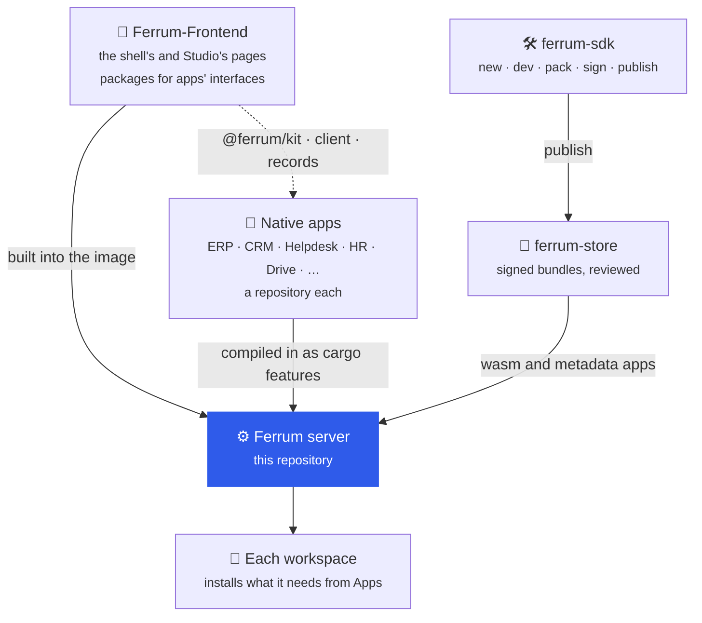

| Repository | What it is |
|---|---|
| [Ferrum-Frontend](https://github.com/CBFerrum/Ferrum-Frontend) | The shell's and Studio's interfaces, and the packages apps build theirs with (`@ferrum/kit`, `@ferrum/client`, `@ferrum/records`); the server's image builds them in |
| [ferrum-sdk](https://github.com/CBFerrum/ferrum-sdk) | Everything needed to build apps: the `ferrum-app` CLI, templates and examples |
| [ferrum-store](https://github.com/CBFerrum/ferrum-store) | The app store and registry: publishing, automatic checks, review and signed bundles |

## Repository layout

| Path | What |
|---|---|
| `crates/calc` | Pure tax/discount/rounding engine (also builds to WASM for the browser) |
| `crates/meta` | Metadata model: packages, entities, overlays, CEL rules, effective schema per tenant |
| `crates/kernel` | Document engine on PostgreSQL: CRUD, lifecycle, permissions, RLS, numbering, audit, outbox, webhooks, automations, print, customization |
| `crates/domain` | ERP engines: ledger, open items, stock valuation, selling/buying flows, stock entries, manufacturing + MRP, India GST, reports |
| `crates/plugins` | WebAssembly plugin host (wasmtime): hooks, routes, WebSockets, schedules, host calls, fuel and memory limits |
| `crates/apps` | Signed `.fapp` app bundles, manifests, permissions and dependency resolution (shared by server, SDK and store) |
| `crates/mcp` | MCP server: every entity, action and report available to AI agents |
| `crates/studio` | Analytics engine and the no-code report builder, charts, number cards, dashboards and Spaces |
| [ferrum-app-erp](https://github.com/CBFerrum/ferrum-app-erp) | ERP's manifests, its interface and its add-ons: Finance, Procurement, Stock Operations, Manufacturing Operations |
| `packages/*` | Shipped packages: `core`, `accounting`, `inventory`, `selling`, `buying`, `manufacturing`, `india` |
| `server` | HTTP API (Loco/Axum), auth, admin, OpenAPI, ERPNext-compatible `/api/resource` shim, CLI tasks |
| `plugins/sdk`, `plugins/examples` | Rust plugin SDK and example plugins |
| `deploy` | Docker Compose and Kubernetes manifests |
| `docs` | [API contract](docs/api.md), [plugins](docs/plugins.md), [operations runbook](docs/operations.md), [security](docs/security.md), [known limits](docs/limits.md), [plan and analysis](docs/plan/PLAN.md) |
| `tools` | `loadtest.py`: a load test of a running server (see the runbook's Capacity section) |

The shell's and Studio's interfaces, and the packages apps build theirs with, live in
[CBFerrum/Ferrum-Frontend](https://github.com/CBFerrum/Ferrum-Frontend); the server's image builds
them in. Apps' own interfaces, ERP's included, come compiled into their crates.

<details>
<summary><b>How the crates depend on each other</b></summary>

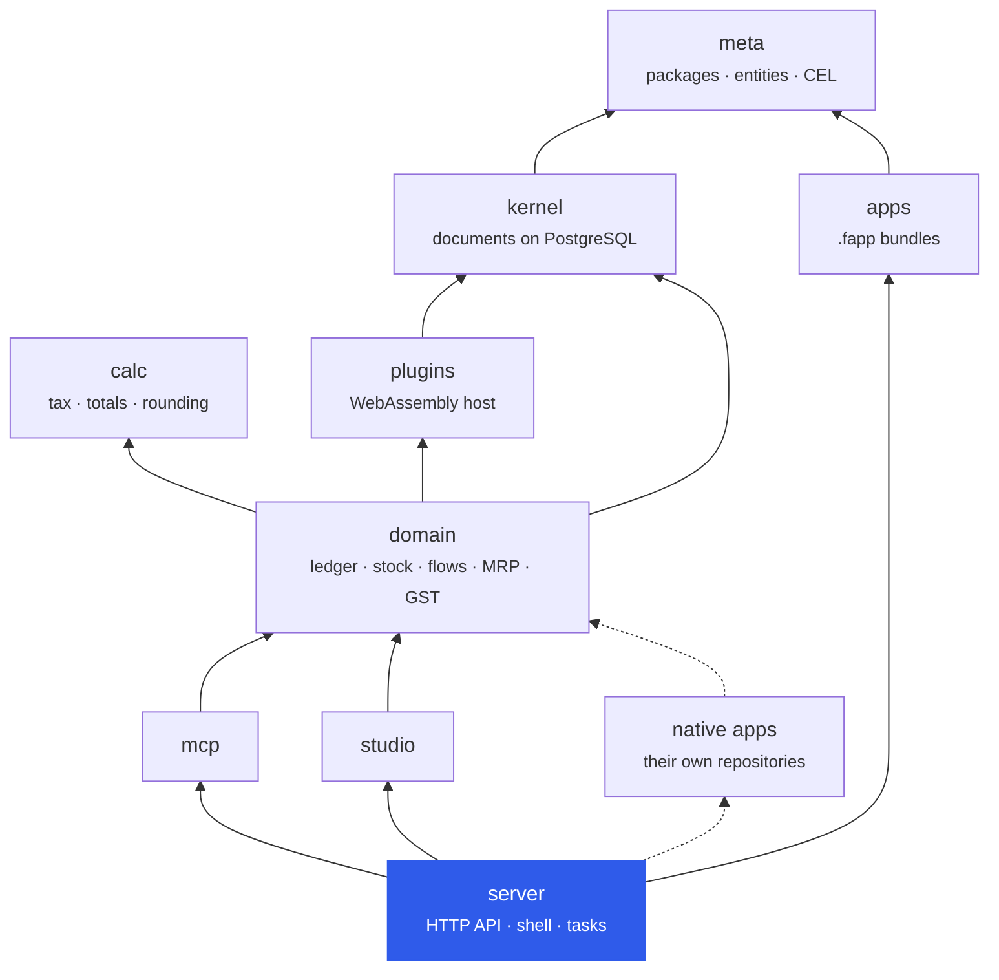

</details>

## Quick start (development)

> [!IMPORTANT]
> Requirements: Rust 1.95+, PostgreSQL 17+, Node 22+.

**1. A database**

```bash
createuser ferrum --pwprompt          # password: ferrum
createdb -O ferrum ferrum_dev
```

**2. The server**

```bash
cd server && cargo run -- start       # http://127.0.0.1:5150 — migrates and syncs the schema at boot
```

**3. A workspace**

```bash
cd server && cargo run -- task create_tenant slug:demo name:"Demo Ltd" email:admin@demo.test password:'Correct-Horse-9' packages:core,accounting,inventory,selling,buying,manufacturing,india
```

**4. Demo data**

```bash
cd server && cargo run -- task seed_demo tenant:demo
```

**5. The interfaces**

The shell's and Studio's interfaces, built from Ferrum-Frontend and registered when the server
starts (rebuild and restart to see a change); ERP's and the other apps' come compiled into their
crates:

```bash
git clone https://github.com/CBFerrum/Ferrum-Frontend web
cd web && npm install && npm run build:apps
cd ../server && FERRUM_UI_DIR=../web/dist-apps cargo run -- start   # http://127.0.0.1:5150/
```

Sign in with tenant `demo`, `admin@demo.test` / `Correct-Horse-9`.

## How it fits together

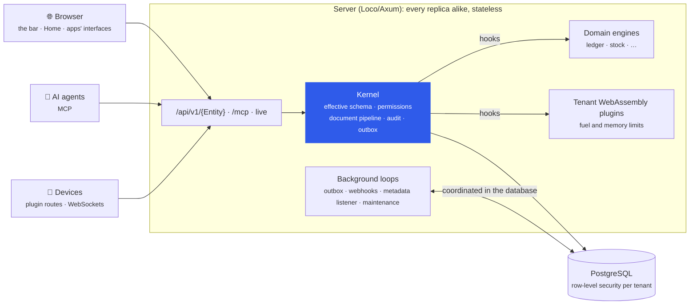

A request resolves the tenant's **effective schema** (shipped packages + installed overlays +
tenant customizations), checks permissions, runs the document pipeline (defaults → links →
`before_validate` hooks → computed fields → metadata rules → `validate` hooks → write → events)
inside one transaction, and records an audit entry and an outbox event in that same transaction.

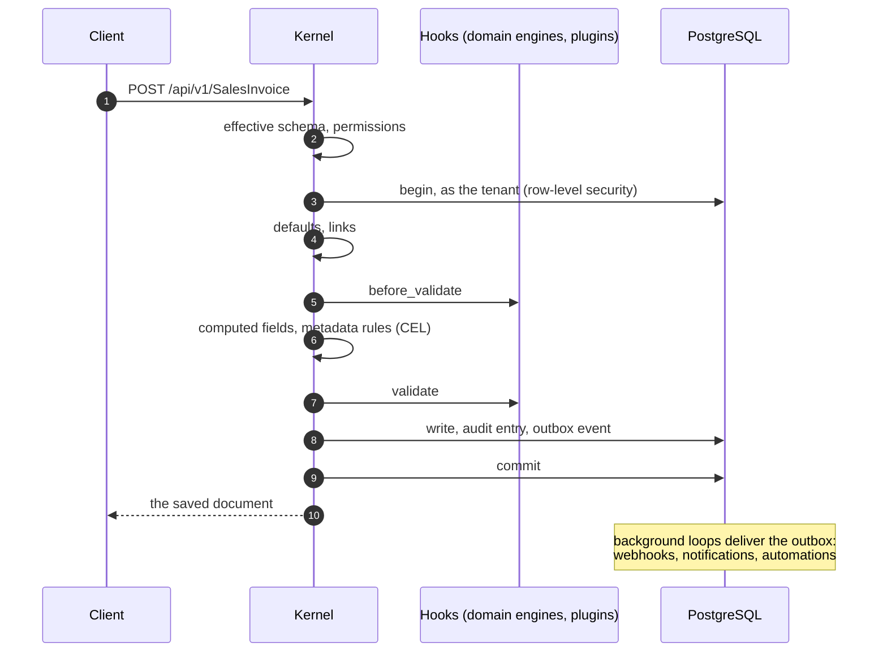

## AI agents (MCP)

Ferrum is an MCP server: `POST /mcp` speaks the Model Context Protocol (Streamable HTTP,
stateless, so any replica answers). Agents get generic, metadata-driven tools that cover every
entity, action, workflow and report of every installed package, customizations included:

| | Tools |
|---|---|
| 🧭 Discover | `ferrum_overview`, `describe_entity` (with a JSON Schema) |
| 🔎 Read | `search_records`, `get_record`, `run_report`, `get_audit_trail` |
| ✏️ Write | `preview_record`, `create_record` (idempotent), `update_record`, `delete_record` |
| 🔁 Lifecycle | `submit_record`, `cancel_record`, `amend_record`, `run_action`, `workflow_transition` |
| 🛠️ Administer | `customize_entity` (administrators) |

Each call runs as the signed-in user with that user's permissions and lands in the audit trail;
tools carry read-only/destructive hints so clients can ask before posting.

```bash
claude mcp add --transport http ferrum https://erp.example.com/mcp --header "Authorization: Bearer fk_..."
```

Create the API key under the user menu (or `POST /api/auth/api_keys`).

Hosted assistants (for example a claude.ai custom connector pointed at `https://erp.example.com/mcp`)
use OAuth 2.1 instead: the server advertises itself through the standard discovery documents,
clients register themselves, and the user signs in and approves the client on a consent page.
Access tokens last an hour and refresh tokens rotate; revoking them or signing out everywhere cuts
the client off.

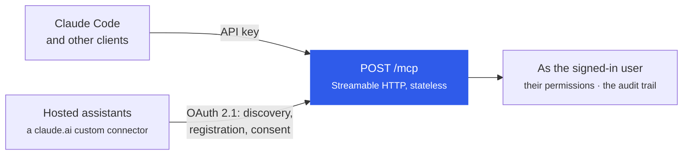

## Customizing without code

| | Need | How |
|---|---|---|
| ➕ | Add a field, option, rule or label | `POST /api/customize` with an overlay op (`add_field`, `set_property`, `add_rule`, `add_options`) — stored per tenant, applied instantly, no DDL |
| ✅ | Validate or derive values | CEL rules/computed fields, e.g. `doc.due_date >= doc.posting_date` |
| 🔀 | Approvals | Workflow overlay (`set_workflow`): states, transitions, roles, CEL guards, maker-checker |
| ⚡ | React to events | Automations (CEL condition → actions) and signed webhooks (HMAC, retries, SSRF guard) |
| 🖨️ | Documents | MiniJinja HTML print templates per entity |
| 🗃️ | New entity | `define_entity` overlay (stored without DDL) |
| 📦 | Bundles | Packages: YAML entities, overlays, roles, seeds and SQL, installed per tenant |
| 🧩 | Custom code | WebAssembly plugins bound to entity hooks — see below |

### Plugins: turn Ferrum into any platform

Plugins are sandboxed WebAssembly modules with a manifest. Beyond document hooks they can bring
their own entities, serve HTTP routes (signed-in or public), hold WebSocket connections to devices
(with subprotocols such as `ocpp1.6`, delivered to whichever replica holds the socket), subscribe
to events, run on schedules and call declared HTTPS hosts — always within the permissions the
administrator approved, with a CPU budget, a memory cap and no other access. That is how Ferrum
becomes an EV charging, IoT, payment or telephony platform without changing its code.

| | A plugin can | Details |
|---|---|---|
| 🪝 | Run on document hooks, `before_validate` to `before_delete` | inside the document's transaction, as the user |
| 🗃️ | Bring its own entities | names start with `X`, stored without DDL |
| 🌐 | Serve HTTP routes, signed-in or public | `/api/ext/{plugin}/…` or `/api/public/{tenant}/{plugin}/…` |
| 🔌 | Hold WebSockets to devices, with subprotocols such as `ocpp1.6` | delivered to whichever replica holds the socket |
| 📣 | Subscribe to outbox events and run on schedules | as its own service user; a failed event retries |
| 📡 | Call HTTPS hosts | declared hosts only, never private addresses |
| 🗝️ | Keep state of its own | private key-value storage per tenant |

Every row is subject to the permissions the administrator approved, a CPU budget (fuel) and a
memory cap. See [docs/plugins.md](docs/plugins.md), the Rust SDK in `plugins/sdk` and the complete
`plugins/examples/device-gateway`. Apps can also bring their own screens (pages, Home widgets,
panels on forms, settings) in sandboxed frames, and offer extension points for add-ons to fill;
ferrum-sdk's `examples/board` shows both.

## Testing

```bash
for db in ferrum_test ferrum_domain_test ferrum_mcp_test ferrum_plugins_test ferrum_studio_test \
          ferrum_apps_api_test ferrum_sso_test ferrum_coedit_test ferrum_assistant_test; do
  createdb -O ferrum $db
done
cargo test --workspace                # unit + integration (resets the test databases)
cd web && npm test
```

> [!NOTE]
> The role the tests connect as must not be a superuser: superusers bypass row-level security.
> Each test database has a `FERRUM_*_TEST_DATABASE_URL` override (for example
> `FERRUM_TEST_DATABASE_URL`, `FERRUM_DOMAIN_TEST_DATABASE_URL`); the object storage test runs
> when `FERRUM_TEST_S3_ENDPOINT` points at an S3-compatible endpoint.

`scripts/smoke.py` is a post-deploy check against a running server (readiness, login, reports,
idempotency, optimistic locking, and 60 concurrent stock issues racing for 100 units).

The domain integration test walks a GST-registered company through opening stock,
procure-to-pay, order-to-cash, payments, credit notes, credit limits, manufacturing, MRP, period
closing, concurrent stock issues, sales returns and plugins, and checks that the trial balance and
balance sheet balance and that stock value equals the stock accounts.

## Deployment

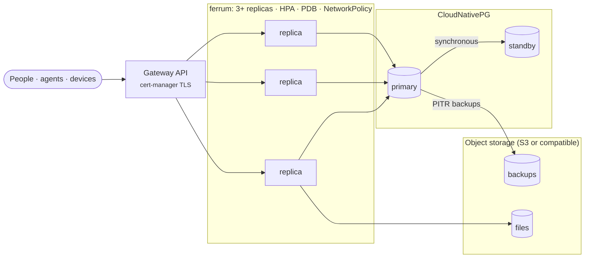

* Image: `ghcr.io/cbferrum/ferrum`, the server, which answers every page (the shell's and Studio's
  interfaces built in from Ferrum-Frontend, apps' compiled into their crates) and the API on one
  origin. It is stateless. The published images are linux/amd64; for ARM hosts (Graviton,
  Ampere), `docker build .` on an arm64 machine produces a working image (checked on Apple
  Silicon: non-root, read-only root filesystem, no capabilities).
* Optional: `ghcr.io/cbferrum/ferrum-editors`, the static server of Drive's browser editors
  (`deploy/editors`, on an origin of its own).
* Optional: a LiveKit server for video meetings (`deploy/meet.yml`; docs/operations.md "Meetings").
* Single host: `deploy/docker-compose.yml`.
* Production: `deploy/k8s` (CloudNativePG with synchronous replica and PITR backups through the
  Barman Cloud plugin, 3+ API replicas, Gateway API routes with cert-manager TLS, PDB, HPA,
  NetworkPolicy, probes), deployed and exercised on a kind cluster in CI (`deploy/kind`) — see
  [docs/operations.md](docs/operations.md).

## Scope and known limits

| | Area | Included |
|---|---|---|
| 📒 | Accounting | Multi-company accounting: journals, payments, multi-currency with exchange differences, periods, budgets, bank reconciliation, period closing, financial statements |
| 💳 | Receivables and payables | Ageing and dunning, subscriptions |
| 🔁 | Selling and buying | Cycles with returns in any of an item's units of measure; procurement (material requests, RFQs, supplier scorecards) |
| 📦 | Inventory | Batches/serials, variants, landed costs, pick lists, quality inspection |
| 🏭 | Manufacturing | BOMs, work orders, job cards, production planning, subcontracting, MRP |
| 🇮🇳 | India GST | GSTIN, place of supply, CGST/SGST/IGST templates, HSN checks, e-invoices with IRN and signed QR codes — sent straight to the IRP or uploaded — e-way bills, a GST tax invoice print |
| 📊 | Analytics | Studio: reports with calculated columns, subtotals and Excel export, charts, dashboards |
| 💬 | Collaboration | Comments, assignments, tags, followers, chat, calendar; PDFs and emailing any document |
| 🔐 | Access and sign-in | Role rules down to records whose fields hold given values, rate limits that hold across replicas, two-factor sign-in (authenticator apps, recovery codes, a workspace policy), single sign-on with OpenID Connect providers |
| ⚙️ | Platform | Live updates, customization, plugins and apps (see above), MCP for AI agents |

> [!NOTE]
> Not yet included: GraphQL, Citus sharding configuration. What is deliberately simpler than you
> might expect is listed in [docs/limits.md](docs/limits.md).

## Documentation

| | Document | What it covers |
|---|---|---|
| 📘 | [API contract](docs/api.md) | Auth, metadata, documents, collaboration, live updates, the shell, reports, administration, apps, search, notifications, MCP, ERPNext compatibility |
| 🧩 | [Plugins](docs/plugins.md) | Writing one, manifests, host calls, extension points, screens, interfaces of their own, limits |
| 🛠️ | [Operations runbook](docs/operations.md) | Components, configuration, first deployment, upgrades, backups, monitoring, scaling, capacity, incident playbooks |
| 🔐 | [Security](docs/security.md) | The model, the controls, and the latest review |
| ⚖️ | [Known limits](docs/limits.md) | What is deliberately simpler than you might expect |
| 🗺️ | [Plan and analysis](docs/plan/PLAN.md) | The plan, the architecture and the design notes behind each part |

## Licence

[AGPL-3.0-or-later](LICENSE).
