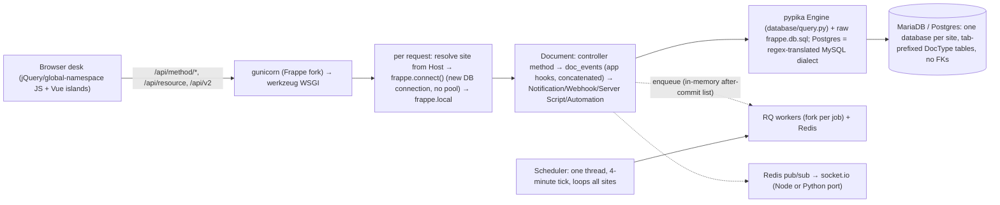

# ERPNext + Frappe: How They Work and Where They Fall Short

Source: `frappe/frappe` and `frappe/erpnext` **17.0.0-dev**, shallow-cloned 2026-10-28 into [`upstream/`](../upstream).
Paths below are relative to `upstream/`.

## Method

| Tool | What it produced |
|---|---|
| **graphify** (AST mode, no LLM) | 7,737 code files → **55,861 nodes, 137,711 edges, 3,617 communities** → [`graphify-out/`](../graphify-out/GRAPH_REPORT.md). Corpus check: 8,839 files / 4.6M words exceeds graphify's warning threshold, so 807 docs/templates, 284 images and 11 audio files were deliberately left out (no architecture signal, LLM cost). Health check flagged 4,683 dangling + 718 self-loop + 5,402 collapsed edges, normal for unresolved third-party calls in AST mode. |
| **REA** (`rea-agents` 6.8.0, `analyze-javascript-application`) | Static reconstruction of the desk frontend `frappe/frappe/public/js`: 439 JS files parsed, 675k AST nodes, 2,405 findings, **0 ES-module application graph** (global-namespace architecture), 44k unresolved dynamic references |
| Code scans | DocType JSON census, LOC, SQL/float/RPC usage counts (scripts in this session) |
| Four parallel audits | Frappe internals, ERPNext domain, market, Rust ecosystem, each citing file:line or URLs |

## By the numbers

| Metric | Value |
|---|---|
| DocTypes | **872** (Frappe 336, ERPNext 536): 375 child tables, 65 singles, 86 submittable, 25 virtual, 14 trees |
| Fields defined | **14,669**, incl. 2,589 Link + 119 Dynamic Link + 432 Table fields |
| Widest DocTypes | Sales Invoice 235 fields, Purchase Invoice 199, POS Invoice 185, Sales Order 176, Delivery Note 169 |
| Python (excl. tests/patches) | Frappe 197.5k + ERPNext 264.5k ≈ **462k LOC**; tests another 361k |
| JavaScript | Frappe 158k (desk 129.5k) + ERPNext 93k; 457 Vue files in the Frappe repo (Studio, Flow, frappe-ui) |
| Schema-churn patches | 882 (Frappe 318, ERPNext 564) |
| RPC surface | **~1,550 `@frappe.whitelist` endpoints** (Frappe 697, ERPNext 855) |
| `flt()` float coercion calls in ERPNext | **4,926** (vs 4 `Decimal(` uses) |
| `frappe.get_doc(` calls | 1,529 (Frappe 715, ERPNext 814): full-document loads incl. all child tables |
| Raw `frappe.db.sql(` | 155 (Frappe 130, ERPNext 25); query-builder (`frappe.qb`) uses 3,508 |
| Client-side form controllers (`frappe.ui.form.on`) in ERPNext | 304 files |
| ERPNext reports | 195 |

### What the knowledge graph says

* **God nodes** (most-connected abstractions): `flt()` 1,861 edges · `Document` 1,577 · `whitelist()` 1,556 · `cint()` 746 ·
  `getdate()` 420. **The single most central function in the whole ERP is a float coercion.** Money flows through
  binary floating point and is rounded after the fact.
* **Low modularity**: the largest communities have cohesion scores of 0.006–0.026. The biggest (1,137 nodes) mixes Frappe
  core DocTypes with ERPNext accounting DocTypes, so framework and app are entangled through `Document` hooks.
* **Import cycles through the framework root**: `frappe/__init__.py` participates in more than 10 cycles (with
  `model/document.py`, `database/__init__.py`, `utils/__init__.py`, `core/doctype/*`). Everything depends on the global
  `frappe` module.
* **Duplicated logic**: `erpnext/controllers/taxes_and_totals.py` (1,476 LOC) and
  `erpnext/public/js/controllers/taxes_and_totals.js` (1,323 LOC) implement the same totals/tax maths twice.
* **PostgreSQL is second-class in ERPNext's own CI**: MariaDB tests run on every PR. Postgres tests run nightly or only on PRs
  labelled `postgres` (`erpnext/.github/workflows/server-tests-postgres.yml:39-44`).

## How Frappe works (v17-dev)

* **Metadata**: DocType JSON in app repos, re-imported on `bench migrate` when the file hash changes
  (`frappe/modules/import_file.py:74-150`). Meta = DocType + Custom Fields + Property Setters, cached per process
  (`frappe/model/meta.py:163-179, 407-474`). DDL by diffing meta vs live table (`frappe/database/schema.py`).
* **Types**: Currency/Float/Percent → `decimal(21,9)` but **read back as float** by both drivers
  (`frappe/database/mariadb/mysqlclient.py:207`, `frappe/database/postgres/database.py:40-46`); Data/Link/Select →
  `varchar(140)`; JSON → `json` (not `jsonb`); Singles → EAV rows in `tabSingles`.
* **Save path**: `SELECT … FOR UPDATE` on parent + children plus a `modified` check
  (`frappe/model/document.py:2179, 922-938, 1682-1713`); removed child rows deleted, **every remaining child row fully
  rewritten** (`1210-1237`); nine wildcard `on_update` hooks on every save (`frappe/hooks.py:240-253`).
* **Lists** go through `model/qb_query.py` → pypika `Engine` with permission injection (`frappe/database/query.py:250-410`), but
  `frappe.qb.get_query` defaults to `ignore_permissions=True` (`query.py:268`) and `get_all` forces it (`__init__.py:1318`).
* **Apps/plugins**: `get_hooks` concatenates ~119 hook names across all apps' `hooks.py` in install order. There's no
  namespacing, priority or conflict detection; consumers pick `[-1]` or `[0]` ad hoc (`frappe/__init__.py:1017-1089, 1485-1488`).
* **New in 2026**: `automation_engine` (transactional trigger queue with dedup keys, well designed), `mcp`
  (`/api/v2/mcp`, **on by default**, OAuth PKCE), `flow` (AI agents with RAG and an LLM code-execution sandbox), `studio`
  (Vue app builder, early), `extend_doctype_class` (mixin composition), Typst print emitter, DuckDB/SQLite backends.
  Frappe is moving, so Ferrum's edge has to be **structural** (integrity, money, ledgers, isolation, scale). Features
  Frappe can ship in one release don't count as an edge.

## Framework deficiencies (Frappe)

Paths relative to `upstream/frappe/frappe/`. ✔ = re-verified by hand in this session.

| # | Impact | Weakness | Evidence | Ferrum answer |
|---|---|---|---|---|
| 1 | High | **No referential integrity**: no FKs/CHECKs in MariaDB or Postgres DDL ✔; link checks in Python are racy and `force` skips them; deletes scan every Link field and every Dynamic-Link table (often unindexed) | `database/mariadb/schema.py:9-69`; `model/delete_doc.py:192, 334-424`; `model/dynamic_links.py:28-52` | Real FKs on UUID keys (§4.6) |
| 2 | High | **Permission paths diverge**: single-doc checks skip `permission_query_conditions`, list queries skip `has_permission`; row rules are raw SQL strings; **`ignore_permissions=True` at 427 call sites** (Frappe 254, ERPNext 173); Query Reports run raw SELECT with no row filter; Server Scripts and Jinja get read-only SQL on any table | `permissions.py:234-286, 488-505`; `database/query.py:1699-1894`; `core/doctype/report/report.py:190-198`; `utils/safe_exec.py:600-608` | One permission model → Cedar (points) + SQL predicates (lists) + RLS (§9) |
| 3 | High | **UI-only business rules**: `depends_on` / `mandatory_depends_on` / `read_only_depends_on` run only in the browser; the server checks only `reqd` ✔, so API clients bypass them | `public/js/frappe/form/layout.js:874`; `model/document.py:3520` | CEL rules evaluated server-side, mirrored client-side (§6) |
| 4 | High | **Blocking DDL inside web requests and migrate**: Custom Field save commits + ALTER TABLE in the request; no `CONCURRENTLY`, no lock hints; NOT NULL ⇒ full-table UPDATE; removed-field columns never dropped | `custom/doctype/custom_field/custom_field.py:220-230`; `database/mariadb/schema.py:75-160`; `database/postgres/schema.py:174-230` | Zero-DDL customization; online expand/contract (§4.3–4.4) |
| 5 | High | **Plugin model = global concatenation**: `override_doctype_class` last-app-wins (others silently dropped); `extend_doctype_class` is MRO mixins (a method without `super()` shadows the rest); fixtures overwritten on every migrate; patches identified by line text, run via `exec()`, no down-migrations | `model/document.py:181-197, 267-322`; `utils/fixtures.py:16-17`; `modules/patch_handler.py:77-110` | Typed, ordered extension points; semver'd packages (§7) |
| 6 | High | **Float money** at the driver boundary and in `flt()` | `utils/data.py:1135-1173` | Decimal end to end |
| 7 | High | **Implicit transactions**: one per request, DDL commits implicitly, **159 `frappe.db.commit()`** in non-test code | `app.py:165-167, 468-478`; `database/database.py:519-526` | Command = transaction (§5) |
| 8 | High | **Side effects are not transactional**: `enqueue_after_commit` defaults to False, the after-commit queue is in memory (no outbox); `deferred_insert` buffers in Redis for 15 min and silently drops records if Redis is down | `utils/background_jobs.py:137, 262-264`; `deferred_insert.py:22-66` | Transactional outbox (§2, §18) |
| 9 | Medium | **Write amplification**: full child rewrites + 9 wildcard hooks + 6 automation dispatchers on every save | `hooks.py:240-253`; `model/document.py:1986-2008` | Diff writes; entity-scoped hooks |
| 10 | Medium | **Naming-series hot lock** ✔ held until commit; deleting the newest doc decrements the counter, so the number is **reused** | `model/naming.py:428-505`; `model/delete_doc.py:205` | Numbering at submit; gapless only where legally required (§4.5) |
| 11 | Medium | **Natural varchar keys**: rename = UPDATE on every referencing column | `model/rename_doc.py:320-332` | UUID PKs; rename is one column |
| 12 | Medium | **Customization collisions**: Custom Field names `{doctype}-{fieldname}`; one Property Setter slot per property (last write wins); uninstall leaves custom columns behind | `custom/doctype/property_setter/property_setter.py:37-40`; `installer.py:551-704` | Namespaced layered overlays with provenance (§4.2) |
| 13 | Medium | **Postgres = regex-translated MySQL dialect**: backticks → quotes, `LOCATE` → `strpos`, ints quoted as strings, client-side mogrify; CI runs PG only on labelled PRs | `database/postgres/database.py:76-127, 383-394, 1045-1125`; `repo:.github/helper/roulette.py:225-243` | Postgres-only, native SQL |
| 14 | Medium | **Runtime limits**: no DB connection pool (`frappe.connect()` per request ✔), sync WSGI (`asgi.py` only hosts socket.io + a WSGI thread pool), fork-per-job RQ, single-threaded 4-minute scheduler | `app.py:212-225`; `asgi.py:19-28`; `utils/scheduler.py:26-60` | Tokio async, pooled connections, Postgres queue |
| 15 | Medium | **Node-local state breaks multi-node**: document locks are local-disk file locks; Error/Access/Activity logs in a per-node SQLite file | `utils/file_lock.py:4-8`; `utils/logging.py:22-50` | All state in Postgres/object storage |
| 16 | Medium | **Sandboxes without limits**: Server Script has no CPU/memory caps and its `get_doc`/`db.set_value`/`get_all` skip permissions; Flow's LLM `execute` sandbox is not covered by the `server_script_enabled` kill switch | `utils/safe_exec.py:99-121, 676-722`; `flow/utils/safe_exec.py:51-72` | WASM fuel/memory limits; host API always permission-checked (§7.4) |
| 17 | Medium | **Audit is opt-in and deletable**: `track_changes` default 0; Administrators can delete Versions; `db_set`/raw SQL writes leave no Version; nothing tamper-evident | `model/document.py:2337-2361` | Append-only hash-chained audit (§9) |
| 18 | Medium | **Schema limits**: EAV singles, no nested child tables, `varchar(140)` everywhere, `json` not `jsonb`, MariaDB row-size cap on fields per DocType | `database/mariadb/schema.py:26-32`; `model/document.py:1968-1984` | Typed settings rows, JSONB, no row-size wall |
| 19 | Low | **API gaps**: no ETag/If-Match (PUT merges into a fresh load; last writer wins unless the client sends `modified`); rate limiting opt-in and site-wide | `api/v1.py:53-62`; `api/v2.py:219-226`; `rate_limiter.py:15-55` | ETags + idempotency keys + per-tenant limits (§15) |
| 20 | Low | **Supply chain / hidden modes**: forks of PyPika and gunicorn; RQ/PyMySQL pinned because internals are used; Python 3.14 only; litellm/lancedb/onnxruntime mandatory in core; 18 global `frappe.flags.in_*` mode flags used 303 times | `repo:pyproject.toml:88-96` | Minimal core; AI as optional packages |

**Frontend coupling (REA + audit):**
* The desk is a global-namespace app (REA found no ES-module application graph). It boots with ~69 keys
  (`boot.py:41-160`) and `getdoctype` ships controller JS and Client Scripts *as source strings* (`desk/form/meta.py:62-151`).
* ~2.7k LOC of the model is re-implemented client-side, and 254 framework DocType JS files exist.
* A separate frontend *is* feasible: API v2, meta endpoint, `run_doc_method`, MCP and the Vue `ui/` package exist. But
  UI-only rules must first move server-side, and that's exactly what Ferrum's CEL rules do.

## Domain deficiencies (ERPNext)

Paths relative to `upstream/erpnext/erpnext/`. Items marked ✔ were re-verified by hand in this session.

| # | Impact | Weakness | Evidence | Ferrum answer |
|---|---|---|---|---|
| 1 | High | **Ledgers are not immutable.** Cancel = UPDATE `is_cancelled=1` + mirror rows; reposting hard-DELETEs and re-inserts GL/Payment Ledger rows ✔; GL/SLE rows get a random hash name and an **hourly job renames up to 50k of them** ✔, so primary keys change after posting | `accounts/general_ledger.py:715-742`; `accounts/utils.py:1735-1738`; `accounts/doctype/gl_entry/gl_entry.py:75-82, 502-526`; `hooks.py:521-522` | Append-only `journal_line`, reversals only, hash chain, UUIDv7 ids fixed at insert (§11) |
| 2 | High | **Float money.** `flt()` returns float; ~5k calls; legacy "banker's" rounding only at precision 0; DB `decimal(21,9)`; **debit/credit may differ by 0.5 (absolute)** and the difference goes silently to round-off ✔; account-currency fallback hard-codes 2 decimals (wrong for JPY/KWD) | `frappe/utils/data.py:1135-1173, 1254-1292`; `accounts/general_ledger.py:452-458` ✔; `accounts/services/taxes.py:385-395` | `rust_decimal` + NUMERIC, zero tolerance, currency-aware rounding with largest-remainder allocation |
| 3 | High | **Valuation reposting**: backdated entries/cancellations/LCVs trigger an unbounded walk forward, rate write-back into submitted docs, commits every 2,000 SLEs (non-atomic), locks every later SLE `FOR UPDATE` ("can match millions of rows"), failures need manual restart | `stock/stock_ledger.py:1034, 1176-1182, 1996-2120`; `accounts/utils.py:1817-1822`; `stock/doctype/repost_item_valuation/repost_item_valuation.py:719-744` | Cost layers + forward-posted revaluation; no cascade by design (§12) |
| 4 | High | **Engine-dependent concurrency**: InnoDB gap locks on MariaDB vs advisory locks on Postgres; interactive deadlocks surface as HTTP 508 with no retry; unlocked check-then-act on payments, credit limit, budget, Bin | `stock/stock_ledger.py:409-446`; `frappe/app.py:418-422`; `stock/stock_balance.py:276-286` | Conditional atomic updates, retry-on-serialization in the command bus, one engine (Postgres) |
| 5 | High | **Redundant derived state repaired by jobs**: outstanding amount stored 3 ways (GL, Payment Ledger, invoice field); Bin counters re-derived by aggregates; a daily "Ledger Health" job compares GL vs payment ledger, so drift is expected | `accounts/utils.py:2206-2254, 2689-2727`; `stock/stock_balance.py:90-152` | One source of truth per fact; projections built from ledgers, never hand-synced |
| 6 | High | **Whole-history scans**: `get_balance_on` sums GL from inception (23 callers); credit-limit, CoA tree, budget checks the same; AR/AP report loads every payment-ledger row into Python | `accounts/utils.py:200-345`; `accounts/report/accounts_receivable/accounts_receivable.py:855-905`; `selling/doctype/customer/customer.py:796-870` | Period snapshots + partition-pruned aggregation (§11) |
| 7 | High | **Row-at-a-time writes**: each GL row inserted via `new_doc().submit()`; O(n²) merge of GL rows; `status_updater` builds SQL per child row; every child row rewritten on every save | `accounts/general_ledger.py:282-313, 372-388`; `controllers/status_updater.py:676-712`; `frappe/model/document.py:1210-1237` | Set-based inserts (`COPY`/multi-row), diff-based child writes |
| 8 | High | **No referential integrity**: no FKs anywhere ✔, `varchar(140)` keys, polymorphic `parenttype`, 78 Dynamic Links, ≥67 untyped Data fields pointing at child-row names | `frappe/database/mariadb/schema.py:13, 28-30` | Real FKs on UUIDs, party supertype (§4.6) |
| 9 | Medium | **≥3.5k LOC of client/server duplication** with proven divergences: zero-qty returns compute opposite results; half-even (Python) vs half-up (JS) rounding; Payment Entry has a second tax engine in both languages; some client-sent fields are trusted (e.g. `ignore_pricing_rule` is permlevel 0 on Sales Invoice) | `controllers/taxes_and_totals.py:237, 771` vs `public/js/controllers/taxes_and_totals.js:258, 728`; `accounts/doctype/payment_entry/payment_entry.py:1589-1730` | One Rust calc crate compiled to WASM for the browser (§16) |
| 10 | Medium | **Customization by runtime DDL**: each Accounting Dimension becomes a Custom Field (ALTER TABLE) on **54 DocTypes** | `hooks.py:620+`; `accounts/doctype/accounting_dimension/accounting_dimension.py:116-172` | `dims` JSONB + derivation rules |
| 11 | Medium | **Finance Books are a tag, not parallel ledgers**; blank-tag rows count in every book; no per-book calendar/currency/close | `accounts/report/financial_statements.py:826-842` | Real parallel ledgers (`ledger_id`) |
| 12 | Medium | **FX**: a live HTTP rate fetch can happen inside GL posting; revaluation per account+party, not per open item, never auto-reversed | `setup/utils.py:139-154`; `accounts/doctype/gl_entry/gl_entry.py:302-322`; `exchange_rate_revaluation.py:187-277` | Rates are data with temporal validity; reversing revaluation per open item |
| 13 | Medium | **MRP** nets once against aggregate projected qty; time-phased MRP is only a report; MPS submit enqueues a `make_mrp` that doesn't exist | `manufacturing/doctype/production_plan/services/material_request.py:680-683`; `master_production_schedule.py:542-551` | Time-phased MRP with planned orders + pegging (§13) |
| 14 | Medium | **Capacity under-counted**: load only counts untouched draft job cards; finite scheduler wired only to Production Plan, forward only | `manufacturing/doctype/job_card/job_card.py:691-697`; `manufacturing/scheduling/DESIGN.md:37,157,176` | Capacity from all open operations; APS phase 4 |
| 15 | Medium | **Budget/credit checks** have no commitment ledger and no locks; budget validation can run twice | `controllers/budget_controller.py:210-291`; `accounts/general_ledger.py:390-395` | Commitment ledger + atomic checks |
| 16 | Medium | **Serial/batch at scale**: one bundle document per row; candidates fetched with `limit(10000000).for_update()` | `stock/doctype/serial_and_batch_bundle/serial_and_batch_bundle.py:2784` | First-class lot/serial tables + genealogy graph |
| 17 | Medium | **Consolidation** at report time only; accounts matched across companies by name string; no eliminations / NCI / ownership % | `accounts/report/consolidated_financial_statement/consolidated_financial_statement.py:236` | Group structures, `partner_company_id`, automatic eliminations (phase 4) |
| 18 | Medium | **Stored eval strings**: pricing-rule conditions `safe_eval`'d; on error the rule is **silently skipped** | `accounts/doctype/pricing_rule/utils.py:82-101`; `controllers/status_updater.py:26-205` | Type-checked CEL / decision tables; errors block publish, not runtime |
| 19 | Low | **No ECO/PLM/approved-vendor model**; BOM versioning by name suffix; submitted BOM costs overwritten in place | `manufacturing/doctype/bom/services/costing.py:89-97` | BOM revisions with effectivity, ECO workflow, AML (§13) |
| 20 | Low | Thin CRM/Quality/Projects; Italian FatturaPA XML built with naive escaping and never transmitted; HR/payroll moved to a separate app; India localization lives in a separate app | `regional/italy/utils.py:360`; `patches/v14_0/remove_hr_and_payroll_modules.py` | Localization as first-class packages |

Also noted:
* **Moving target**: an in-flight "services" refactor (91 files, 24.6k LOC under `*/services/`).
* **34 explicit `frappe.db.commit()`** calls outside tests/patches, so background jobs commit partway.
* **Three global validators run on every save of every DocType**, e.g. the SLA engine (`hooks.py:414-420`).
* **Schema churn is rising**: 100 patches in v13, 68 in v14, 86 in v15, 114 in v16.

## Domain ideas worth keeping

1. The draft → submit → cancel/amend lifecycle, re-implemented as append-only postings.
2. Per-voucher "GL composers" feeding a single posting sink. Make that sink the only writer.
3. A dedicated open-item subledger (Payment Ledger + `against_voucher`).
4. Period closing snapshots (Account/Stock Closing Balance), made the *mandatory* read path.
5. Valuation method per item, including Standard Cost (no reposting cascade).
6. Accounting dimensions as configurable analytic axes with per-account rules (as data, not DDL).
7. Ordered tax charge types ("on net total", "on previous row") with a normalized item-wise tax breakup.
8. Document mapping chains (Quotation → SO → DN → SI) with line-level back-references driving fulfilment status.
9. Typed regional overrides and a registry of dimension-carrying DocTypes.
10. The new finite scheduler's capability-based resource model.

## Framework ideas worth keeping

1. **DocType as data** driving DDL, forms, lists, API, print and search: the core idea Ferrum is built on.
2. **Layered customization** (Custom Field + Property Setter), redone as namespaced, ordered layers with provenance.
3. **Explicit lifecycle events** and the docstatus submit/cancel/amend model, with before/after diffs.
4. **APIs derived from metadata** (REST, RPC, meta, MCP).
5. **Role × permlevel, User Permissions, sharing, masking** as concepts, compiled into one engine down to RLS.
6. **The Automation Engine's transactional trigger queue** (dedup key, drainer, depth guard), which is close to Ferrum's outbox.
7. **`extend_doctype_class`-style composition**, but with explicit ordering.
8. **Per-tenant databases and per-site app enablement** → Ferrum's dedicated tier + per-tenant packages.
9. **Version + Deleted Document history with restore.**
10. **Pluggable print renderers** (Frappe added a Typst emitter too) and virtual DocTypes as adapters for external data.
