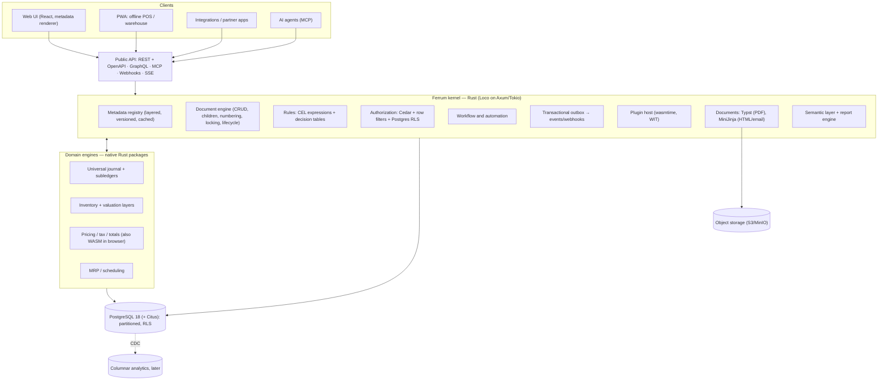

# Ferrum — Target Architecture (Rust + PostgreSQL)

> Codename **Ferrum** (iron, the thing rust is made of). A metadata-driven ERP kernel in Rust on PostgreSQL that keeps
> what Frappe/ERPNext got right (DocTypes as data, docstatus lifecycle, customize-without-code), and removes the
> structural limits found in [analysis-erpnext.md](analysis-erpnext.md).
> Library picks and versions are in §3.

---

## 0. Goals and non-goals

**Goals**

1. Feature parity with ERPNext's core (accounting, stock, buying, selling, manufacturing, projects, assets, CRM-lite), then
   exceed it in finance (multi-GAAP, consolidation), supply chain (MRP/APS, WMS), and platform (customization, plugins, scale).
2. **Zero-code customization** of data model, UI, logic, process, security, outputs, integrations, with upgrades that
   don't break it.
3. **Plugin-first**: first-party modules ship as packages on the same extension API third parties use.
4. **Correct by construction**: exact decimal money, append-only ledgers, integrity enforced by Postgres (FKs, CHECKs,
   temporal constraints), no history rewriting.
5. **Scale-out by design** across tenants (sharding) and within a tenant (partitioning, replicas, company sharding).
6. **API-first, separate frontend**: the shipped UI uses only public APIs.

**Non-goals for v1:** HR/payroll (integrate or partner), e-commerce storefront, a BI warehouse, MariaDB support,
Windows desktop installers.

**About "infinitely scalable":** no system is. Ferrum scales *out* along two axes. Tenants are spread across Citus
nodes. A single tenant is split by time partitions, read replicas and, at the extreme, by company. §17 lists the real
ceiling of each axis and what comes after it.

---

## 1. Principles

| # | Principle | Replaces (ERPNext) |
|---|-----------|--------------------|
| 1 | Metadata is the product. Entities, fields, views, rules, workflows, policies, reports and templates are versioned data. | DocType JSON synced on `bench migrate` |
| 2 | Let Postgres guarantee what it can: FKs, CHECK, RLS, partitions, temporal constraints, JSONB, generated columns. | Integrity in Python, no FKs |
| 3 | Ledgers are append-only. Corrections post forward; history is never rewritten. | Repost Item Valuation / reposting GL |
| 4 | Exact money: `rust_decimal` + `NUMERIC`, currency-aware rounding, `f32/f64` banned in domain crates by lint. | `flt()` floats (most-connected node in the code graph) |
| 5 | One calculation engine: pure-Rust pricing/tax/totals compiled natively *and* to WASM for the browser. | `taxes_and_totals.py` + `.js` duplicated (1,476 + 1,323 LOC) |
| 6 | Customizations are overlays, never edits. The effective schema is a deterministic merge of layers. | Property Setters / Custom Fields per site, fixtures |
| 7 | Plugins attach to typed, ordered extension points inside a sandbox, so monkey-patching is impossible. | `hooks.py`, last-app-wins class overrides |
| 8 | Every row carries `tenant_id`; RLS on; Citus-ready from day 1. | site-per-database only |
| 9 | Small, generic, versioned API derived from metadata + explicit domain actions. | ~1,550 ad-hoc `@frappe.whitelist` endpoints |
| 10 | Boring, mature libraries first (Loco, SeaORM/SeaQuery, wasmtime, Cedar, CEL, Typst). Build only the ERP-specific kernel. | — |

---

## 2. System overview



A **command** (create/update/submit/cancel/action) is one database transaction. It runs:

`authenticate → load effective metadata (cached) → authorize (Cedar) → validate (schema + CEL + hooks) → domain engine (post to journal / stock) → write rows + audit + outbox → commit → async: events, webhooks, search index, notifications`.

---

## 3. Stack (batteries-included, mature libraries)

Versions and maturity verified on 2026-10-28 (crates.io / npm / GitHub). **Bottom line: Loco is the platform shell;
the runtime-entity engine is our own code on SeaQuery + sqlx.** SeaORM (and Loco's generators and tenancy helper) only
work with compile-time entities. Jobs, search, tenancy and events stay in Postgres until load proves otherwise.

| Concern | Pick (version) | Why | Watch-outs |
|---|---|---|---|
| App shell | **Loco 1.2.0** ([crates](https://crates.io/crates/loco-rs)): Axum + Tokio + SeaORM | Config/env, controllers, **Postgres job queue** (`queue.kind: Postgres`), cron scheduler, mailer via worker, OpenDAL storage (S3/GCS/Azure), cache, tasks, multi-DB, test helpers ([docs](https://github.com/loco-rs/loco/blob/master/website/src/content/docs/docs/how-to/choose-queue-backend.md)). Handlers are plain Axum, so no lock-in | Its 1.2 `multi-tenancy` is an app-side `.in_tenant()` filter, **not RLS** ([docs](https://github.com/loco-rs/loco/blob/master/website/src/content/docs/docs/how-to/multi-tenancy.md)), so we add RLS ourselves. JWT is HS-only, so we add OIDC/JWKS. 1.1 and 1.2 had breaking changes: pin versions |
| System tables | **SeaORM 2.0.4** | Typed models for kernel/engine tables (meta, journal, moves, audit) | `sea_orm::dynamic` is unstable and **cannot define runtime entities** ([docs](https://docs.rs/sea-orm/2.0.4/sea_orm/dynamic/struct.Entity.html)) |
| Runtime entities + DDL | **SeaQuery 1.0.2** + **sqlx 0.9.0** | Builds DDL and DML from runtime names with bound values; sqlx 0.9's `AssertSqlSafe` guards non-static SQL | — |
| Database | **PostgreSQL 18.6** on **CloudNativePG 1.30**, **PgBouncer 1.26**, **pg_partman 5.5** | `uuidv7()`, `WITHOUT OVERLAPS`/`PERIOD` temporal keys, `RETURNING OLD/NEW` (cheap audit diffs), async I/O (reads/vacuum up to 3×), B-tree skip scan | Virtual generated columns can't be indexed (use STORED). PG 19 is RC: wait for 19.1 |
| Scale-out | **Citus 14.3** (PG 16–18): row-based sharding on `tenant_id` for pooled tenants, **schema-based** for big/dedicated tenants ([docs](https://docs.citusdata.com/en/stable/develop/reference_ddl.html)) | Real Postgres; tenant joins stay on one node; distributed schemas pick up new tables automatically | **AGPL-3.0** (legal review); row-based needs `create_distributed_table` for every package-created table |
| Expressions | **CEL**: `cel 0.15` (renamed from `cel-interpreter`) | Not Turing-complete, no side effects: safe for tenant-written rules | Small project (★700). Rhai 1.27 only if imperative scripts are ever needed (set op limits) |
| Decision tables | **zen-engine 2.1.6** + `@gorules/jdm-editor` (React) | Ships both the no-code editor and the Rust evaluator | Single-vendor format |
| No-code data mapping | **jaq** (`jaq-core 3.1`) | jq semantics in Rust | Needs a visual mapper UI on top |
| Authorization | **Cedar 4.14** (CNCF Sandbox) | In-process, policy-as-data, formally verified | Weak at "list everything I can see". Lists use our SQL predicate compiler (§9). OpenFGA is the runner-up |
| Plugins | **Wasmtime**, **pinned to LTS 48** (24-month support) + component model, **WASI 0.3** (ratified 2026-06-11), wit-bindgen 0.63 | Fuel (deterministic) + epoch (wall-clock) + memory limits; typed WIT contracts | Extism 1.41 is simpler but non-component ABI |
| Low-code scripts | JS via **Javy 9.1** (the Shopify Functions pattern); Python via componentize-py 0.25 | Same sandbox as plugins; Javy is proven at Shopify scale | componentize-js/py are 0.x; interpreted guests burn more fuel |
| REST + OpenAPI | Axum + **utoipa 6.0** builders at runtime (`OpenApiBuilder`/`PathsBuilder`) | Spec generated per tenant from effective metadata | — |
| GraphQL (phase 2, optional) | **async-graphql 7.2.1** `dynamic-schema` | Runtime schema per tenant | 8.0 has been stuck at RC with no commits since 2026-04 |
| Jobs | Loco Postgres queue → **apalis 1.0 + apalis-postgres** if more control is needed | Enqueue in the same transaction as the business write | apalis is two weeks past 1.0 |
| Durable workflows | Postgres state table + jobs (enough for approvals/SLAs); **Temporal** (`temporalio-sdk 1.1`, server MIT) as the upgrade path | Proven durable execution | Rust SDK GA only since Sep 2026. **Restate's server is BSL 1.1**, which restricts platform-style use with tenant-registered endpoints, so avoid it |
| BPMN | **bpmn-js 18** as editor/import format only, compiled to our state machine | Mature editor | No usable Rust BPMN engine; bpmn-js watermark must stay |
| Search | Postgres FTS + `pg_trgm` → **ParadeDB pg_search 0.26** + **pgvector 0.8.7** | Index updated in the same transaction | ParadeDB is AGPL; Meilisearch clustering is BSL |
| Analytics | Read replicas + materialized views → CDC into **ClickHouse**; **Perspective 5.6** (`@perspective-dev`) for in-browser pivots | Keeps OLAP off the OLTP primary | `pg_duckdb` momentum slowing; `@finos/perspective` frozen |
| CDC / events | Transactional outbox + **supabase/etl** (logical replication) → **NATS JetStream** (async-nats 0.51) | Rust-native CDC, single-binary broker | etl installs from git; schema-change handling beta |
| Documents | **Typst 0.15.1** via `typst-as-lib 0.17` (PDF) + **MiniJinja 3.0** (HTML/email); `chromiumoxide` only for imported ERPNext HTML formats | In-process PDFs, no browser fleet for native formats | Typst Rust API is 0.x; typst-as-lib has one maintainer (vendor it if needed) |
| Money | **rust_decimal 1.43** + **iso_currency 0.7** + our own `Money` type | Exact, `Copy`, sqlx/SeaORM support | Max ~28 significant digits, so generated `NUMERIC` precision is capped at 28 |
| Offline (phase 3) | **Electric 1.8** (Apache-2.0, read sync) + our write path; or **PowerSync** | Local-first POS/warehouse | PowerSync service is FSL source-available, not OSS |
| Frontend | React + **TanStack** (Query 5 / Router 1 / Table 9 / Form 1) + **shadcn**; **AG Grid Community 36** (MIT) for dense line-item grids; wasm-bindgen 0.2.129 for the shared calc crate | Headless, metadata-drivable | AG Grid pivots/row-grouping/SSRM are paid Enterprise. Leptos/Dioxus are pre-1.0: don't build the main UI on them |
| Testing / telemetry | cargo-nextest, proptest 1.12, testcontainers 0.28, insta 1.49, **turmoil 0.7** (simulation), Goose 0.18 (load); tracing + OpenTelemetry 0.33 | Standard, maintained | OTel Rust *tracing* is still Beta |

**Avoid:**
* **PgCat**: stale since early 2025.
* **PgDog**: no cross-shard joins/CTEs yet; watch it.
* **wkhtmltopdf**: archived.
* **Glide Data Grid**: stale since 2024.
* **sqlxmq, underway**: stale.
* **madsim**: use turmoil instead.
* **jsonlogic-rs**: stale.
* **SpiceDB from Rust**: no maintained client.
* **Self-hosted Neon**: OSS repo nearly idle.
* **Seaography 2 / SeaORM Pro**: still RC / idle.
* **Rust BPMN engines**: hobby-scale.
* **Old crate names**: `cel-interpreter` → `cel`, `temporal-sdk-core` → `temporalio-sdk`, `pg_replicate` → supabase/etl.

**Licence watch:** Citus, ParadeDB and PgDog are AGPL-3.0. Restate and Meilisearch Enterprise are BSL. PowerSync is FSL.
All are fine for an AGPL Ferrum. For a permissive or proprietary Ferrum, get a legal review before bundling them.

---

## 4. Metadata kernel

### 4.1 Entity model

| Entity kind | Meaning | ERPNext analogue |
|---|---|---|
| `document` | Transactional; lifecycle `draft → submitted → cancelled` (+ amend) | submittable DocType |
| `master` | Reference data, editable, versioned | normal DocType |
| `child` | Line items owned by a parent | `istable` DocType |
| `settings` | One record per tenant/company | Single DocType (`tabSingles`) |
| `tree` | Hierarchy (closure table or `ltree`) | `is_tree` (nested set) |
| `virtual` | Backed by a plugin/connector, not a table | virtual DocType |
| `ledger` | Append-only, posted only by engines (journal, stock moves) | GL Entry / SLE |

Field types: about 30, the same family as Frappe (Data, Int, Decimal, Currency, Percent, Date, Datetime, Duration,
Check, Select, Link, Dynamic Link, Table, Table MultiSelect, Text/Markdown/Code, Attach, Image, JSON, Geolocation,
Rating, Color, Barcode, Signature, Phone, Email, URL…). Layout fields (Tab/Section/Column) are **not** fields. They move into
separate *view* metadata, so the same entity can have several role-specific forms.

Each field carries: type, label, i18n, required / unique / index, default (CEL), computed (CEL or native),
options, currency-of (for amounts), precision, validation (CEL), UI hints (`visible_if`, `readonly_if`, `required_if` as CEL),
storage (§4.3), and `locked` (base invariants overlays may not loosen).

### 4.2 Layers and the effective schema

```
kernel  →  core packages  →  industry/localization packs  →  marketplace plugins  →  tenant  →  user personalization
```

* Every metadata object is stored as **(layer, package, version, JSON document)** in `meta.object`.
* Overlays are typed patch ops: `add_field`, `set_property`, `hide`, `add_option`, `add_rule`, `replace_template`,
  `add_view`… The ops can't delete base objects or loosen `locked` constraints.
* `effective(tenant) = fold(layers, ops)` is computed once per (tenant, metadata version). It's cached in memory, invalidated
  with `LISTEN/NOTIFY`, and compiled into: SQL plans, CEL programs, Cedar schema/policies, GraphQL/OpenAPI schema,
  JSON Schema for the UI.
* Identifiers are **namespaced**: tenant fields `x_*`, plugin fields `<pkg>__*`. A future base field can therefore never
  collide with a customization (the ERPNext "custom field clashes after upgrade" class of bug).

### 4.3 Storage strategy (zero-DDL customization)

| What | Where it lives | Why |
|---|---|---|
| Kernel and core-package fields | Real typed columns | Our migrations, our indexes |
| Plugin / localization / tenant custom fields | `ext JSONB` column on every table, keys namespaced | **Instant, no ALTER TABLE, no downtime, no row-size limits**; works in shared (pooled) tables |
| Hot custom fields that need filtering or aggregation | Expression index on `(ext->>'x_field')` (partial per tenant when pooled) | Indexed without a column |
| Same, in a dedicated tenant DB | Optionally promoted to a `STORED` generated column (indexable) or a real column by a background job | Full speed when one tenant owns the table |
| Tenant-created entities | Pooled: `core.custom_record (tenant_id, entity, id, number, data jsonb)` + child table. Dedicated: real tables | Same pattern Salesforce/NetSuite use for custom objects |

The query compiler hides this. `customer.x_credit_tier` compiles to a column or a JSONB path depending on the tenant's tier.
JSONB values are validated against the effective schema on write, and `pg_jsonschema` CHECKs can back that up.

### 4.4 Schema evolution

* Only kernel and package upgrades run DDL. Tenants never trigger DDL.
* Expand → migrate → contract. Additive ops (`ADD COLUMN` nullable/defaulted) are metadata-only in Postgres.
  Destructive ops are deferred to a later release. Large backfills run as resumable background jobs.
* Every DDL runs with `lock_timeout` + retry. Index builds use `CONCURRENTLY`.
* `sea-orm-cli generate entity` against a CI database regenerates typed Rust entities for core tables. There's no custom codegen.

### 4.5 Identity and numbering

* PK = `(tenant_id, id uuid v7)` (time-ordered, index-friendly, generated by Postgres 18 `uuidv7()`).
* The human number (`SINV-2026-00042`) is a separate column built by **numbering rules** (prefix templates with
  company / branch / fiscal year / date tokens). Gapless where the law requires it (a counter row locked only *at submit*);
  otherwise a fast non-gapless sequence.
* **Renaming is free**: links store UUIDs, so changing a customer code no longer rewrites every referencing table
  (Frappe `rename_doc`).

### 4.6 Integrity in the database

* Link fields are **real foreign keys** `(tenant_id, x_id) → target(tenant_id, id)`. Deleting a referenced record fails in
  the DB instead of a cross-table scan in Python.
* Child tables: FK to parent `ON DELETE CASCADE`, with a per-parent physical child table. That means no polymorphic
  `parenttype` columns.
* Dynamic links (polymorphic) are kept to a minimum: party = supertype table `core.party` with customer/supplier/employee
  subtypes, so a payment links to `party_id` with an FK.
* Effective-dated data (prices, exchange rates, tax rates, BOM revisions, assignments) uses Postgres 18 **temporal
  constraints** (`PRIMARY KEY (..., valid WITHOUT OVERLAPS)`), so overlapping validity is impossible by construction.
* CHECK constraints for enums/ranges. Ledger tables reject `UPDATE/DELETE` (privileges + trigger).

---

## 5. Document engine

* **Common columns:** `tenant_id, id, number, company_id, status, docstatus, version, created_*, updated_*, ext`.
* **Optimistic concurrency:** `version` integer with `If-Match` ETags on the API. Writes are `UPDATE ... WHERE version = $n`.
* **Child rows:** diff-based upsert (insert new / update changed / delete removed), never "delete all and reinsert".
* **Reads:** parent + children in one round trip (`json_agg` subqueries), DataLoader batching for GraphQL, keyset pagination.
* **Lifecycle pipeline** (each stage is an ordered extension point):
  `before_validate → validate → before_save → after_save → before_submit → on_submit → before_cancel → on_cancel → on_change`.
  Stages run inside the command transaction; any stage can veto with a typed error.
* **Idempotency:** every mutating API call accepts `Idempotency-Key`; results are stored for 24h.
* **Amend:** cancel + new draft linked by `amended_from` (the ERPNext semantics users already know).
* **Bulk:** set-based bulk insert/update/submit APIs with per-row error reports (data import uses the same path).

---

## 6. Logic tiers — from no-code to code

| Tier | Who | Mechanism | Examples |
|---|---|---|---|
| 0 Declarative | anyone | field properties | required, unique, ranges, regex, options |
| 1 Expressions | power user | **CEL**, type-checked against the entity at save time | `amount > 0`, `visible_if: doc.is_export`, computed `qty * rate` |
| 2 Decision tables | analyst | **zen-engine (JDM)** tables/graphs, versioned and effective-dated, with a simulator | pricing, discounts, tax determination, approval matrix, account determination |
| 3 Scripts | implementer | JS/TS or Python snippets compiled to WASM (Javy / componentize-py) and run in the plugin sandbox | custom validations, small integrations |
| 4 Plugins | developer | WASM components (any language) or native Rust (first-party only) | localization packs, connectors, industry modules |

CEL is non-Turing-complete, side-effect free and always terminates. A broken expression is rejected **before** it
reaches production, not at runtime. Decision tables can be "replayed" against last month's documents to show the effect of
a change before it's published.

---

## 7. Package & plugin system

### 7.1 Everything is a package

`accounting`, `inventory`, `sales`, `manufacturing`, `in-gst`, a tenant's own bundle: all are packages with a manifest,
metadata, optional WASM components, optional UI extensions, data migrations and tests. Packages are installed, upgraded
and removed **per tenant at runtime**: no `bench get-app`, no rebuild, no restart.

```yaml
package: in-gst
version: 1.4.0
kernel: ">=1.0, <2.0"
depends: { accounting: "^1.2", sales: "^1.0" }
capabilities:                       # approved by the tenant admin at install
  entities: { read: [Customer, SalesInvoice], write: [SalesInvoice] }
  http: [ "api.einvoice.example.gov.in" ]
  secrets: [ gsp_credentials ]
provides:
  metadata: metadata/*.yaml         # fields, entities, views, rules, workflows, reports, print templates
  components: [ wasm/gst.wasm ]
  ui: [ ui/gstin-field.js ]         # web component, sandboxed
hooks:
  - on: SalesInvoice.before_submit
    run: gst.validate_invoice
    after: [ accounting ]           # deterministic ordering between packages
```

### 7.2 Extension points (WIT interfaces)

* **Document hooks**: every lifecycle stage. Synchronous, in-transaction, can veto.
* **Computed fields, default providers, numbering providers, validators.**
* **Actions**: buttons/commands with typed parameters, exposed in UI and API automatically.
* **HTTP endpoints**: namespaced at `/api/ext/<package>/…`.
* **Event subscribers**: async, from the outbox, at-least-once with event ids for idempotency.
* **Scheduled jobs, report data sources, connectors.**
* **UI slots**: field widgets, form side panels, dashboard cards as Web Components in a sandboxed iframe/shadow DOM.

Host API imported by plugins: `data` (query/get/insert/update, always through the full permission + validation
pipeline, with rights = plugin capabilities ∩ invoking user), `events.emit`, `http.fetch` (allow-listed), `kv`, `secrets`,
`log`, `i18n`, `money` (decimal ops).

Sketch of the plugin contract (WIT, trimmed):

```wit
package ferrum:plugin@0.1.0;

interface types {
  type json = string;                       // canonical JSON of a document / patch
  record ctx { tenant: string, user: string, locale: string, request-id: string }
  variant hook-result { ok, patch(json), veto(string) }   // veto = typed validation error
}

interface data {                             // imported from the host; every call is permission-checked
  use types.{ctx, json};
  get:    func(c: ctx, entity: string, id: string) -> result<json, string>;
  query:  func(c: ctx, entity: string, filter: json, fields: list<string>, limit: u32) -> result<list<json>, string>;
  insert: func(c: ctx, entity: string, doc: json) -> result<string, string>;
  update: func(c: ctx, entity: string, id: string, patch: json, expected-version: u32) -> result<_, string>;
}

interface hooks {                            // exported by the plugin
  use types.{ctx, json, hook-result};
  on-document: func(c: ctx, entity: string, stage: string, doc: json) -> hook-result;
  on-event:    func(c: ctx, topic: string, payload: json);
  action:      func(c: ctx, name: string, args: json) -> result<json, string>;
}

world package {
  import data;
  // + outbound HTTP via wasi:http (WASI 0.3), host enforces the allow-list
  export hooks;
}
```

### 7.3 Why this ends plugin conflicts

* No class overrides and no monkey-patching. Plugins can only attach to declared points.
* Hook order = topological sort of `before/after` declarations, then priority, then name. Cycles are rejected at install.
* Interfaces are semver'd WIT worlds. The kernel supports N-1, and the marketplace CI tests every package against the
  current and next kernel.

### 7.4 Sandbox and limits

wasmtime with the pooling allocator (instantiation in µs), fuel + epoch interruption (CPU), a memory cap (e.g. 64 MB),
no ambient filesystem/network, per-tenant concurrency quotas. A misbehaving plugin is throttled, then auto-disabled with
an alert. It can't take the tenant down.

### 7.5 Distribution

Packages are **OCI artifacts** (reuse any container registry), signed (Sigstore/cosign), with SBOM. The marketplace
shows capabilities, compatibility matrix and reviews.

---

## 8. Customization lifecycle (what makes "no code" safe)

1. **Sandboxes**: clone a tenant's metadata (and optionally an anonymized data sample) into an environment.
2. **Change-sets**: every customization is a reviewable diff (fields, rules, workflows, templates…). Change-sets can be
   approved, promoted dev → test → prod, and **rolled back**.
3. **Static checks on promote**: CEL type-checking, reference checks (a rule using a hidden field), policy analysis,
   hook-cycle detection.
4. **Upgrade preview**: a new base version is applied to a sandbox first. The analyzer reports broken references and replays
   the tenant's recorded regression scenarios. Only then is prod upgraded. This is SAP's "clean core" delivered by
   construction instead of by governance.
5. **Export as package**: a tenant's change-sets can be bundled as a package and published to the marketplace.
6. **AI-assisted**: "add a warranty-expiry date to serial numbers and alert 30 days before" produces a change-set in a
   sandbox for a human to review (§19).

---

## 9. Security and authorization

* **AuthN**: Loco sessions/API keys, plus our own OIDC/JWKS verification (Loco's JWT is HS-only), SAML SSO, MFA, SCIM
  provisioning, and OAuth2 for third-party apps.
* **AuthZ**: one declarative permission model (roles, record rules, field groups, sharing) compiles to
  (a) **Cedar** policies for point decisions and policy analysis (who-can-do-what, segregation-of-duties checks), and
  (b) **SQL predicates** for lists, reports and search, so row-level security is applied *in the query*, not after it.
* **Tenant isolation**: Postgres **RLS** on `tenant_id` (`SET LOCAL app.tenant_id` per transaction, which is safe behind
  PgBouncer transaction pooling) as a second wall even if application code has a bug. Policies use
  `tenant_id = (select current_setting('app.tenant_id')::uuid)` so the value is computed once per statement and indexes
  are used. Policy columns are indexed, and only LEAKPROOF operators appear in policies.
* **Field-level** read/write per field group (Frappe permlevels, generalized).
* **Segregation of duties** rules (e.g. "create supplier" vs "approve payment") flagged at role assignment.
* **Audit**: append-only `audit.event` (monthly partitions): actor, action, entity, JSON-Patch diff, request id,
  hash-chained per tenant/day, so it's tamper-evident (supports audit-trail regulations such as India's MCA rule).
* PII field encryption (envelope keys via KMS), secrets vault, signed plugins, `cargo-deny`/`cargo-vet`, SBOM.

---

## 10. Workflow and automation

* **Document workflows** as metadata: states, transitions (action, roles/policy, CEL guard, required fields, side
  effects), parallel / N-of-M approvals, approval matrices via decision tables, delegation, SLA timers, escalations.
* **Automations**: `trigger (event | schedule | webhook) → condition (CEL) → steps` (create/update docs, notify, call plugin,
  wait for event/timer, human task). This unifies Frappe's Notification, Assignment Rule, Auto Repeat and Webhook.
* **Durable execution**: step state is checkpointed in Postgres, and steps are idempotent and resumable after crashes.
  Timers and retries go through the job queue. Temporal (MIT server, Rust SDK GA since Sep 2026) is the upgrade path if
  flows outgrow Postgres. Avoid Restate: its BSL licence conflicts with tenant-registered endpoints.
* **Visual designers**: React Flow for automations; bpmn-js as an import/export format for process models.

---

## 11. Finance core

**Money.** `rust_decimal::Decimal` in Rust, `NUMERIC(28,9)` amounts, `NUMERIC(28,12)` unit costs. Currency precision
(0/2/3) defines document rounding. Line math runs in full precision. Rounding differences are distributed by
largest-remainder, so totals always reconcile without a mysterious "Round Off" plug.

**Universal journal** (the SAP ACDOCA idea, on Postgres):

```sql
CREATE TABLE acc.journal_line (
  tenant_id uuid NOT NULL, entry_id uuid NOT NULL, line_no int NOT NULL,
  ledger_id uuid NOT NULL,                 -- parallel ledgers: IFRS, local GAAP, tax, management
  company_id uuid NOT NULL, account_id uuid NOT NULL,
  posting_date date NOT NULL, fiscal_period int NOT NULL,
  party_id uuid,                           -- FK to core.party (customer/supplier/employee)
  txn_currency char(3) NOT NULL, txn_amount numeric(28,9) NOT NULL,   -- signed: + debit / - credit
  local_amount numeric(28,9) NOT NULL, group_amount numeric(28,9) NOT NULL,
  quantity numeric(28,9), uom text,
  cost_center_id uuid, profit_center_id uuid, project_id uuid, segment_id uuid,
  partner_company_id uuid,                 -- intercompany, drives eliminations
  dims jsonb NOT NULL DEFAULT '{}',        -- tenant-defined dimensions, no schema change
  source_entity text NOT NULL, source_id uuid NOT NULL, source_line_id uuid,
  PRIMARY KEY (tenant_id, posting_date, entry_id, line_no)
) PARTITION BY RANGE (posting_date);
```

* **Invariants in the DB**: a deferred constraint trigger checks `Σ local_amount = 0` per (entry, ledger) at commit;
  `UPDATE/DELETE` are revoked; inserts into closed periods are rejected; entries are hash-chained.
* **Balances without hot rows**: closed periods get a snapshot at close. Open periods are aggregated from the period's
  partition with covering indexes. There's no global running-balance row to lock (the contention that sinks posting throughput).
* **Account determination** (which account a sales line hits) is a decision table, not code.
* **Dimensions**: new analytical dimensions are a metadata change (stored in `dims`, derivation rules as decision tables).
  Today ERPNext *injects custom fields into every GL-affecting DocType* for this.
* **Subledgers**: `acc.open_item` + append-only `acc.allocation` for AR/AP, with rule-based auto-matching for payments and
  bank statements.
* **Period close cockpit**: per-module period status (open / soft-close / closed), task checklist with dependencies,
  automated FX revaluation (reversing), accruals, depreciation, allocations, inventory true-up, intercompany reconciliation.
* **Multi-GAAP**: posting rules decide which ledgers receive each line; GAAP differences post to specific ledgers only.
* **Tax engine**: determination via decision tables (place of supply, party/item tax category); inclusive/exclusive,
  compound, reverse charge, withholding; e-invoicing in localization packages.
* **FX**: rate types (spot, average, closing, budget) with temporal validity. Rates are fetched by a scheduled
  connector, **never inside a posting transaction**.
* **Commitments**: budget encumbrances (PR/PO) and customer credit exposure live in a commitment ledger. Checks are atomic
  (a conditional update on the exposure row), not "sum everything, then hope nobody else posted".
* **Consolidation (phase 4)**: group structures with ownership %, currency translation (CTA), automatic intercompany
  eliminations using `partner_company_id`, minority interest.

---

## 12. Inventory core — no more reposting

* `inv.move` is the append-only stock ledger: item, location, lot/serial, signed qty, uom, timestamp, source line, unit cost,
  value, cost-layer refs.
* `inv.balance` holds on-hand per (item, location, lot), updated transactionally with a conditional
  `UPDATE … WHERE qty + $delta >= 0`, so negative stock is prevented under concurrency without table locks.
* **Valuation** per company/item policy:
  * *Moving average*, perpetual at posting time.
  * *FIFO* via `inv.cost_layer` (remaining qty/value). Outflows consume layers in order (the Odoo valuation-layer model).
  * *Standard cost* with variance accounts (PPV, usage, efficiency), the norm for manufacturers.
  * *Period-end actual costing* (optional, SAP Material Ledger style): one true-up entry per item per period.
* **Backdated postings never cascade.** A late receipt or adjustment is valued with the layers available at its timestamp.
  The resulting difference posts *forward* as a dated revaluation entry in the open period. Nothing after it is
  re-computed. This is the standard SAP/Oracle behaviour, and it removes ERPNext's Repost Item Valuation queue (and its
  lock contention and hours-long jobs) by design. Backdating into a closed inventory period is not allowed.
* **Serial/lot genealogy**: first-class tables plus a traceability graph (serial → consumed lots → supplier lots). Recall
  queries are one recursive CTE.
* **Reservations and ATP**: time-phased supply/demand, the same data MRP uses.
* **WMS (phase 3)**: location hierarchy, putaway/picking strategies as decision tables, waves, handling units/LPN, cycle
  counts, offline-capable scanning PWA.

---

## 13. Manufacturing core

* **BOM revisions with effectivity** (temporal constraints), alternates, phantoms, co/by-products, and an **approved
  manufacturer list** (internal part → MPNs) for electronics.
* **Engineering change orders (ECO/ECN)** with workflow, impact analysis (open orders, stock, costs), and BOM diff.
  Import BOMs from CAD/PLM (KiCad, Altium, EasyEDA CSV) as a connector package.
* **MRP**: time-phased netting, lot-sizing rules, safety stock, lead times, full pegging. It runs as a parallel Rust job,
  where Rust is at its best: a 100k-item explosion is a seconds-scale job.
* **Routing and capacity**: work centers, calendars, finite-capacity scheduling (phase 4) with a MIP/CP solver
  (HiGHS via `good_lp`, or OR-Tools).
* **Shop floor**: work orders, operations, time capture, quality inspections, serial assignment, machine/test-rig data via MQTT.
* **Costing**: standard cost roll-up, WIP accounting, variance analysis.

---

## 14. Reporting and analytics

* **Semantic layer** = effective metadata (entities and links form the join graph). The no-code report builder compiles to
  SQL with the permission predicates from §9 always applied. Group/pivot/chart/schedule/email.
* **Financial statement templates** as metadata (account ranges → lines → formulas), with multi-ledger and multi-currency
  options.
* Heavy reports run on **read replicas** with `statement_timeout` and per-tenant concurrency caps.
* **Analytics (phase 3+)**: CDC (supabase/etl over logical replication) into ClickHouse for BI. Perspective handles
  in-browser pivots. Postgres 18 virtual generated columns expose `ext` fields to BI tools as normal columns (they're not
  indexable; use STORED where an index is needed).

---

## 15. API and integration

* **REST** `/api/v1/{entity}`: CRUD, filter DSL, field selection, keyset pagination, bulk ops,
  `/api/v1/{entity}/{id}/actions/{action}`, ETags, idempotency keys. **OpenAPI is generated at runtime per tenant** from
  effective metadata.
* **GraphQL (phase 2, optional)**: per-tenant dynamic schema, DataLoaders to prevent N+1.
* **MCP server**: every entity and action exposed as tools for AI agents. They run through exactly the same permission
  pipeline as the UI and REST: one policy model, no `ignore_permissions` escape hatch.
* **Events**: signed webhooks with retries + DLQ, SSE/WebSocket live updates, CDC stream.
* **No-code mapping** for inbound payloads (JSONata/jq-style via `jaq`) → documents.
* **ERPNext compatibility shim**: `/api/resource/{DocType}` and common `/api/method/frappe.client.*` endpoints, so
  existing integrations keep working during migration (§ roadmap).

### 15.1 Migration from ERPNext (`tools/erpnext-import`)

| Source | Target | Automation level |
|---|---|---|
| DocType JSON, Custom Field, Property Setter | Entities, fields, view metadata, tenant overlays | Fully automatic |
| Link/Table/Dynamic Link fields | FKs / child tables / party links | Automatic (Dynamic Links mapped by `*_type` field) |
| Workflow, Notification, Assignment Rule, Auto Repeat, Webhook | Workflow + Automation metadata | Automatic |
| Client Script `depends_on`/`mandatory_depends_on` (`eval:` expressions) | CEL `visible_if` / `required_if` | Automatic for the common expression subset; rest flagged |
| Server Scripts (Python) | JS/Python snippets in the WASM sandbox, or CEL | Assisted (LLM-drafted, human-reviewed) |
| Print Formats (Jinja) | MiniJinja HTML templates (Jinja-compatible) with a `frappe.*` filter shim; Typst for new formats | Mostly automatic |
| Data: masters, open documents, opening balances | Ferrum tables (UUIDs minted, `name` → `number`) | Automatic |
| GL Entry / SLE history | `journal_line` / `inv.move` + reconstructed cost layers | Automatic, then **parity report**: trial balance and stock value per period must match exactly |
| Integrations calling `/api/resource` / `frappe.client.*` | Compatibility shim | Keep working unchanged |

---

## 16. Frontend (separate)

* Separate TypeScript app that uses only the public API. Third parties can build their own UI.
* **Metadata renderer**: Form, List, Kanban, Calendar, Gantt, Tree, Map, Report, Dashboard. A new entity gets a full UI with
  zero frontend code.
* **Spreadsheet-grade line entry** (virtualized grid, keyboard-first, paste from Excel), command palette, global search.
* **Shared calculation engine**: `ferrum-calc` compiled to WASM computes totals/taxes/prices in the browser,
  **bit-identical** to the server.
* **Designers**: form/list/report/workflow/automation/print-template/decision-table editors, which are just metadata editors.
* **Offline (phase 3)**: PWA with local-first sync for POS and warehouse scanning: Electric (Apache-2.0, read sync) plus
  our idempotent command API for writes. PowerSync is the alternative if its FSL licence is acceptable.

---

## 17. Multi-tenancy and scale-out

| Axis | Approach | Practical ceiling | Next step |
|---|---|---|---|
| Many tenants | `tenant_id` leading every PK/index; RLS; **Citus row-based distribution by `tenant_id`**, all tables co-located, so tenant queries stay on one node. Package-created tables get `create_distributed_table` in the same migration; tenant custom entities live in the already-distributed `custom_record`, so tenants never trigger DDL | effectively unbounded by adding nodes; rebalance shards online | per-region clusters (data residency) |
| Big / dedicated tenants | **Citus schema-based sharding** (a schema per big tenant, placed on its own node). New tables in a distributed schema are picked up automatically, so physical custom columns are allowed here | one node per big tenant | dedicated cluster |
| Big tenant: data volume | Range partitions by period on ledgers/moves/audit; partition pruning; old partitions → cheaper storage | billions of journal lines | archive partitions to object storage, query via FDW/DuckDB |
| Big tenant: reads | Read replicas for reports/search/API GETs; caching of effective metadata in-process | linear with replicas | columnar analytics via CDC |
| Big tenant: writes | No hot rows (numbering at submit, balances from partitions, conditional stock updates); short transactions | one primary's write capacity (~tens of thousands of lines/s on good hardware, to be benchmarked) | distribute that tenant by `(tenant_id, company_id)` |
| App tier | Stateless Rust pods behind a load balancer; autoscale | linear | — |
| Jobs | Postgres-backed queue (`SKIP LOCKED`) | thousands of jobs/s per DB | NATS JetStream |
| Tier isolation | *Pooled* (shared tables) for SMB; *dedicated* DB for enterprise; same schema, tenant moves via logical replication | — | — |

Noisy-neighbor control: per-tenant rate limits, statement timeouts, work_mem caps, job concurrency quotas, and
per-tenant metrics (CPU-ms, rows, storage) for fair billing.

---

## 18. Robustness

* **Transactions**: one command = one transaction; outbox row in the same transaction; at-least-once delivery with
  idempotent consumers; automatic retry on serialization/deadlock errors. No network I/O and no partial commits inside a
  command. Long jobs are chunked into separate idempotent commands.
* **No global hooks on every save**: hooks bind to specific entities and stages. Each hook's latency is traced, and a
  slow hook is visible per tenant.
* **Testing**
  * Property-based tests (`proptest`) for invariants: journals balance, stock never negative unless allowed, valuation
    equals Σ layers, numbering gapless where required.
  * **Differential testing against ERPNext**: the same business scenarios run on ERPNext and Ferrum, and GL/stock
    outputs are compared line by line. This is how parity is proven, not argued.
  * Snapshot tests (`insta`), Postgres integration tests (`testcontainers`), fuzzing (`cargo-fuzz`) for CEL/filter parsers,
    load tests (Goose), deterministic network/failure simulation (`turmoil`), chaos tests (kill pods/DB failover
    mid-posting).
* **Operations**: CloudNativePG (or managed Postgres) HA, PITR via pgBackRest/WAL-G, per-tenant logical export/import,
  quarterly restore drills, zero-downtime rolling deploys (expand/contract migrations).
* **Observability**: `tracing` + OpenTelemetry (tenant, user, entity, command on every span), Prometheus metrics, slow-query
  capture, per-tenant dashboards.

---

## 19. AI layer (on top of the metadata, not bolted onto screens)

* **Ask**: natural language → semantic-layer query → SQL with permission predicates, with the generated query shown.
* **Customize**: describe a change → generated change-set in a sandbox → human approval (§8).
* **Capture**: invoices, POs and bank statements → draft documents (vision model + validation rules).
* **Watch**: anomaly detection on journals and payments (duplicates, unusual accounts/amounts, SoD breaches).
* **Agents**: the MCP server exposes entities/actions to external agents. Agents act as scoped users, every action is
  audited, and financial postings can require human approval.
* Model-agnostic provider interface. No model is required to run the ERP.

---

## 20. Concept map: ERPNext → Ferrum

| Frappe / ERPNext | Ferrum | What changes |
|---|---|---|
| DocType (JSON in app repo) | Entity definition in `meta.object`, layered | Runtime, per-tenant, versioned, diffable |
| `name` as primary key | `id uuid v7` + `number` column | Rename is a one-column update; FKs possible |
| Link / Dynamic Link (varchar) | FK to `(tenant_id, id)` / `core.party` supertype | DB-enforced integrity |
| Child table (`parent`, `parenttype`, `parentfield`) | Per-parent child table with FK + `ON DELETE CASCADE` | No polymorphic parents |
| Single DocType (`tabSingles` key-value) | `settings` entity: one typed row per tenant/company | Typed, indexable |
| Custom Field / Property Setter | Tenant-layer patch ops; values in `ext` JSONB | No ALTER TABLE, no migrate |
| Customize Form | Form/list/view designers editing view metadata | Several views per entity and role |
| Client Script / Server Script | CEL expressions; JS/Python snippets compiled to sandboxed WASM | Type-checked, resource-limited |
| `hooks.py` `doc_events` | Ordered extension points declared in package manifest | Deterministic multi-package ordering |
| `override_doctype_class` | Not possible by design | Extension points only |
| Fixtures + `patches.txt` | Packages + change-sets + versioned migrations | Install/upgrade per tenant at runtime |
| Workflow / Notification / Assignment Rule / Auto Repeat / Webhook | Workflow engine + one Automation model | Durable, resumable |
| Print Format (Jinja → PDF) | Typst templates (PDF), MiniJinja (HTML/email) | Fast, deterministic rendering |
| Report Builder / Query Report / Script Report | Semantic-layer reports; plugin report sources | Permissions in SQL; read replicas |
| User Permissions + `permission_query_conditions` | Declarative permission model → Cedar + SQL predicates + RLS | One model, analyzable |
| GL Entry + Payment Ledger Entry | `acc.journal_line` (multi-ledger, signed amounts) + `acc.open_item`/`allocation` | Append-only, partitioned |
| Stock Ledger Entry + Bin + Repost Item Valuation | `inv.move` + `inv.balance` + `inv.cost_layer` | Forward-posted corrections, no reposting |
| Accounting Dimension (injected custom fields) | `dims` JSONB + derivation rules | Metadata change only |
| RQ + Redis workers | Loco background workers on a Postgres queue | No Redis required |
| Site-per-database multitenancy | `tenant_id` + RLS + Citus; dedicated DB tier | Shardable |
| `/api/resource`, `/api/method/*` | `/api/v1` REST, GraphQL, MCP (+ compatibility shim) | Generated, versioned, typed |
| bench CLI | `ferrum` CLI (Loco tasks) + in-app package manager | No server-side app installs per tenant |

### Example: an entity definition (base layer) and a tenant overlay

```yaml
# packages/sales/metadata/sales_invoice.yaml  (base layer)
entity: SalesInvoice
kind: document
label: Sales Invoice
numbering: "SINV-{fiscal_year}-{seq:5}"
company_scoped: true
fields:
  - { name: customer,      type: link, to: Customer, required: true, locked: true }
  - { name: posting_date,  type: date, default: "today()", required: true }
  - { name: currency,      type: link, to: Currency, default: "customer.default_currency" }
  - { name: items,         type: table, of: SalesInvoiceItem, min_rows: 1 }
  - { name: grand_total,   type: currency, currency_of: currency, computed: native(calc.totals), readonly: true }
rules:
  - { name: due_after_posting, check: "doc.due_date >= doc.posting_date", message: "Due date is before posting date" }
lifecycle: { submit: [accounting.post_invoice, inventory.post_delivery_if_update_stock], cancel: reverse }
---
# tenant overlay (generated by the form designer, stored as a change-set)
overlay: SalesInvoice
ops:
  - add_field: { name: x_project_code, type: data, label: Project Code, after: customer, index: true }
  - add_rule:  { name: x_big_deal_needs_po, check: "doc.grand_total < 1000000 || doc.po_no != ''",
                 message: "Orders above 10 lakh need a customer PO number" }
  - set_property: { field: posting_date, readonly_if: "doc.docstatus == 1 || !has_role('Accounts Manager')" }
```

---

## 21. Repository layout

```
ferrum/
  Cargo.toml                 # workspace
  crates/
    app/          # Loco app: boot, config, auth, routes, workers, tasks, mailers
    meta/         # metadata types, layers, merge, validation, JSON Schema
    schema/       # DDL planner (SeaQuery), migrations, ext-field indexing
    data/         # document engine, query compiler, numbering, locking
    rules/        # CEL + decision tables
    authz/        # permission model → Cedar + SQL predicates
    workflow/     # state machines, automations, durable steps
    events/       # outbox, webhooks, subscriptions
    plugins/      # wasmtime host, WIT worlds, capability checks
    docs/         # Typst/MiniJinja rendering
    reports/      # semantic layer, report builder
    api/          # REST/OpenAPI, GraphQL, MCP generation
    calc/         # pricing/tax/totals: no I/O, builds for wasm32
    ledger/       # universal journal, subledgers, close
    inventory/    # moves, balances, cost layers, reservations
    mfg/          # BOM/ECO, MRP, routing, costing
  packages/       # first-party packages: metadata + Rust hooks (accounting, inventory, sales, buying, mfg, crm…)
  wit/            # plugin interface definitions (semver'd)
  tools/erpnext-import/      # Frappe DocType/customization/data importer + parity checker
web/                         # separate frontend repo
```

---

## 22. Implementation status (2026-10-28)

The first implementation lives in [this repository](../../README.md). Where it differs from this design:

| Area | Design | Built | Why / next |
|---|---|---|---|
| Authorization | Cedar policies + RLS | Role permissions (entity × action, own/all), field permission groups, record/company scopes, maker-checker workflows, and RLS on every table | One model covers lists and single records; Cedar can be layered on for attribute policies |
| Plugins | WIT component model, host `data` API, capabilities | Core WebAssembly modules with a JSON ABI and **no imports** (wasmtime 48 LTS, fuel + memory limits, fail-closed), bound per tenant to entity × stage | Pure functions are safe to run inside the posting transaction; the host API and component model come next |
| OpenAPI | utoipa builders | JSON generated at runtime from each tenant's effective schema | Fewer moving parts; same result |
| Documents | Typst PDFs + MiniJinja | MiniJinja HTML print templates | PDF rendering is the next document feature |
| Jobs / events | Loco queue or apalis, NATS later | Transactional outbox + webhook sender + maintenance loops on every replica, coordinated in Postgres | No extra infrastructure; at-least-once with event ids |
| Database | PostgreSQL 18, Citus | Tested on PostgreSQL 17; every key leads with `tenant_id`; journal partitioned by year | Citus/pg_partman when a deployment needs them |
| Decision tables, BPMN, GraphQL, AI layer, offline | Planned | Not built | Phase 2+ |
| India e-invoice / e-way bill | GSP integration | GSTIN validation, place of supply, CGST/SGST/IGST template selection, HSN checks, IRN/e-way fields | Submission needs a GSP contract |
